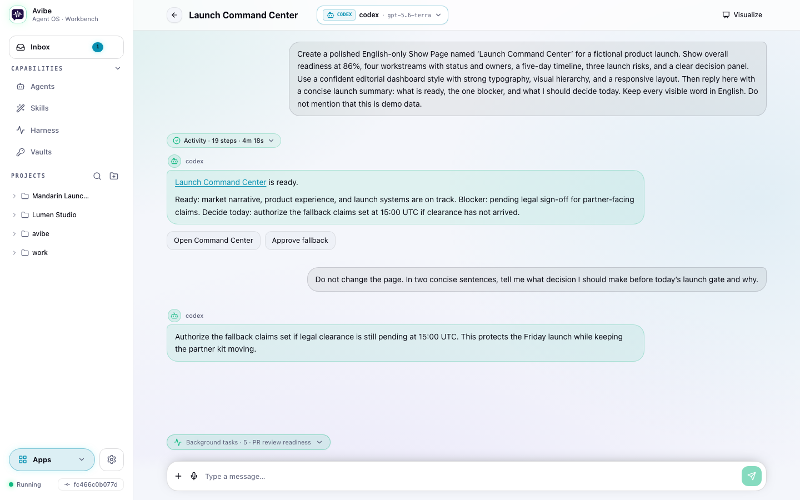
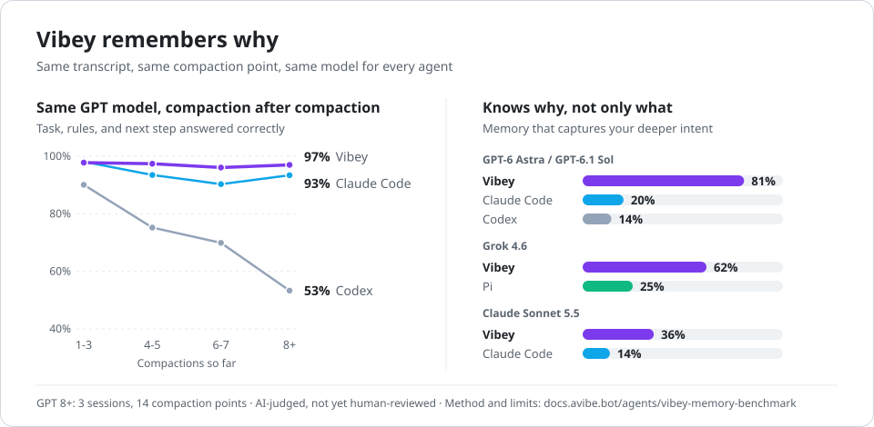
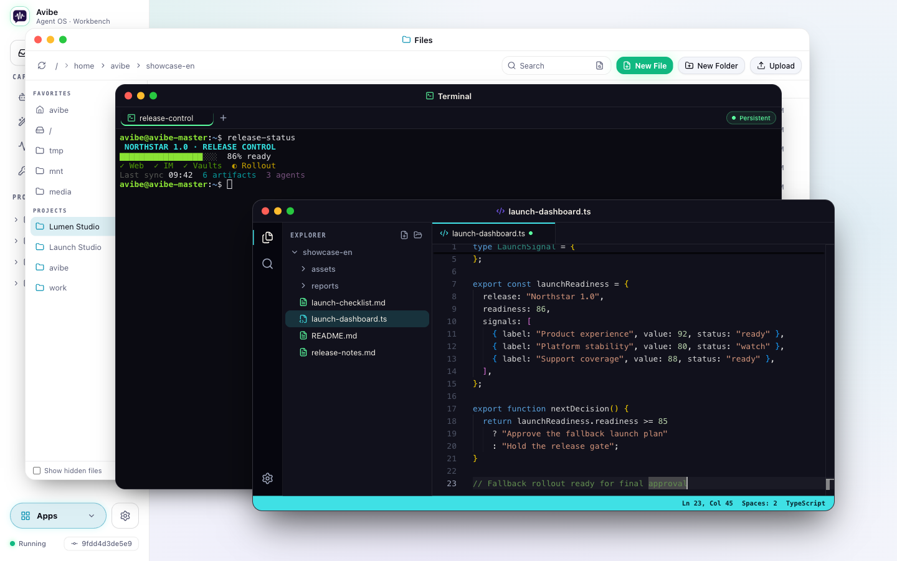
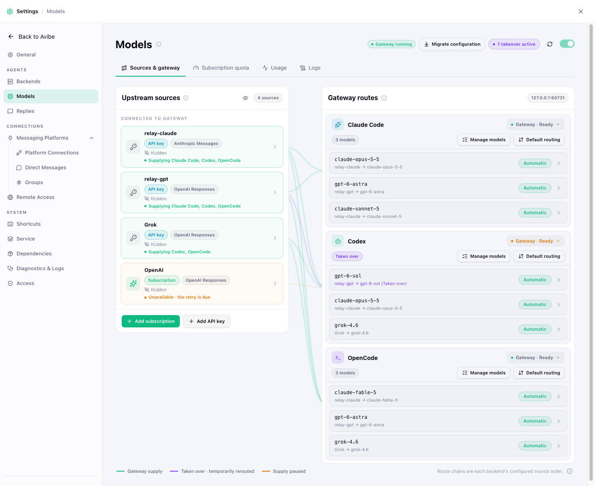
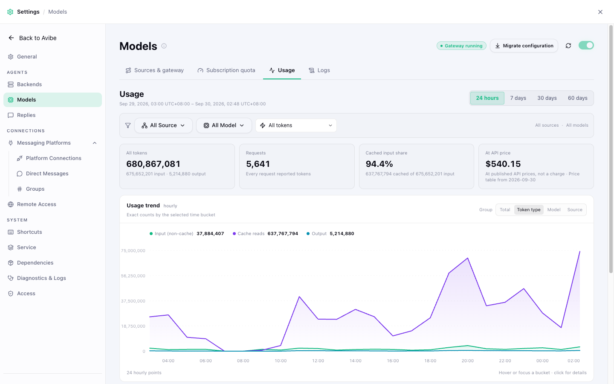
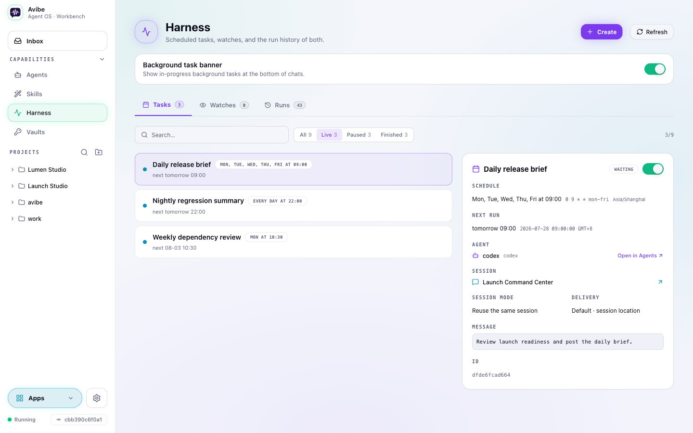
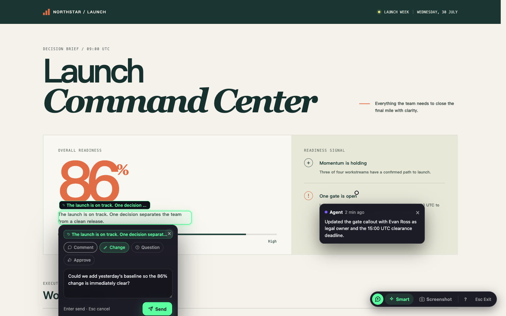
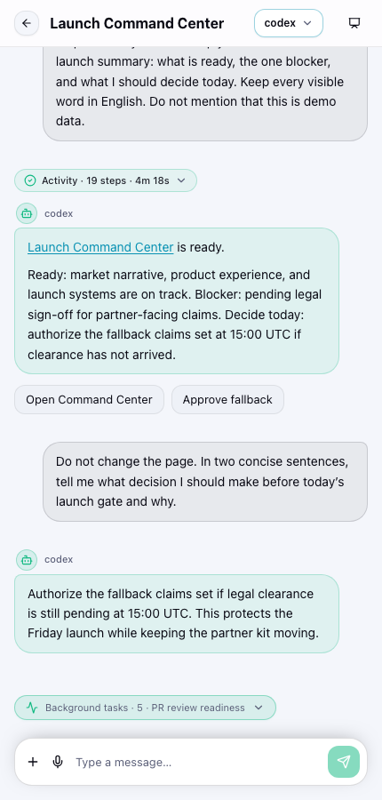
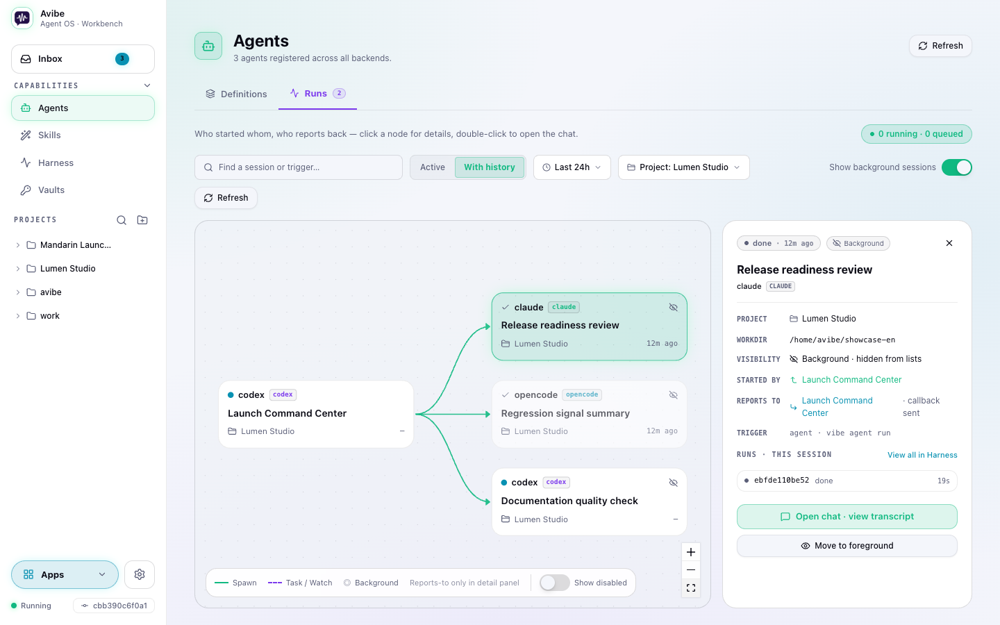

<div align="center">


# Avibe

### Make your computer a home for your AI partner.

**Vibey, Avibe's built-in AI partner, works out of the box — and Claude Code, Codex, and OpenCode can move in too.**<br/>
Avibe is the local-first Agent OS: a Workbench, durable tasks, Model Hub, Show Pages, and Vaults, all running on your own machine and reachable from your browser, phone, or chat app.

[](https://github.com/avibe-bot/avibe/stargazers)
[](https://github.com/avibe-bot/avibe/releases/latest)
[](https://www.python.org/)
[](LICENSE)

[Docs](https://docs.avibe.bot) · [English](README.md) · [中文](README_ZH.md)

**Agents**    

**Reach it from**      

</div>

<br/>

<!-- Hero image: replace this one path when the Vibey screenshot is ready. -->


## Get started

```bash
bash -o pipefail -c 'curl -fsSL https://avibe.bot/install.sh | bash -s -- --launch'
```

**Sign in with a subscription you already have, or add an API key, and Vibey is ready. No CLI to install.** The browser opens a three-step wizard that wires up your models, finds any agents you already use (one click installs the ones you pick), and drops you into the Workbench.

> Open source — read the [install script](https://github.com/avibe-bot/avibe/blob/master/install.sh) first if you like. The short URL is a 307 redirect to that file.

<details>
<summary><b>On Windows?</b></summary>

We recommend WSL on Windows for the best compatibility — see [Run Avibe with WSL from scratch](docs/WINDOWS_WSL.md). It covers where to install WSL, which terminal to use, where to run the install command, and how to open the Web UI.
</details>

---

## Meet Vibey — the AI partner that lives on your computer


Vibey is Avibe's own agent: built in, always on, nothing extra to install. Give it a model from Model Hub, and it is ready in the Workbench and in every chat app you connect.

Reads the room. Picks up where you left off. Asks the right question when it's unsure. Goes quiet when you're heads-down. Ships at 2am because that's when the vibe hits — then leaves a note about what it touched. Holds opinions. Says thanks when you fix its bugs.

> Avibe is the home. Vibey is the AI partner who lives there.

<br clear="all"/>

### 🧠 It remembers why

Long work forces every agent to condense its earlier conversation, again and again. Each time, Vibey rebuilds its memory around what matters: the long-term goal, your requirements in your own words, and the next step — and, far more often than the other agents we measured, why you want them.

<picture>
  <source media="(prefers-color-scheme: dark)" srcset="assets/benchmark/vibey-memory-en-dark.svg">
  
</picture>

- **97% after 8+ compactions.** On the same GPT model, Vibey still answers what the task is, what the rules are, and what comes next 97% of the time. Claude Code: 93%. Codex: 53%.
- **Highest in 8 of 9 head-to-head results** across three models and three measures. The exception is the long-term goal on Claude Sonnet 5.5, Claude Code's native model (99% vs 96%); on the same model, Vibey keeps more of your requirements (89% vs 78%).
- **Knows why, not only what.** Memory that captures your deeper intent: Vibey 81% vs Claude Code 20% and Codex 14% (GPT), 62% vs Pi 25% (Grok), 36% vs Claude Code 14% (Sonnet).

<sub>Avibe's internal benchmark on 6 real long sessions and 55 compaction points; every agent gets the same transcript, compaction point, and model. AI-judged, not yet human-reviewed; full method and limits in the docs.</sub>

→ [How Vibey remembers](https://docs.avibe.bot/agents/vibey-memory) · [Memory benchmark](https://docs.avibe.bot/agents/vibey-memory-benchmark)

### ⏰ It keeps its own timeline

Vibey schedules Tasks, waits on Watches, and runs work in the background, then comes back to the same conversation when there is something worth your attention. Say *"Watch this PR and come back when there's actionable review feedback"* and get on with your day; even a long command it starts turns into a Watch that reports back on its own. → [Harness](https://docs.avibe.bot/concepts/harness)

### 📱 You can reach it anywhere

The browser Workbench, your phone, Slack, Discord, Telegram, WeChat, or Lark / Feishu — the same Vibey on the same machine. When text is not enough, it answers with a Show Page: a live dashboard, diagram, or report you can point at and comment on. → [Show Pages](https://docs.avibe.bot/concepts/show-pages)

Under all three, it does the hands-on work. Vibey reads, writes, and edits files, runs commands (`bash` on macOS and Linux, PowerShell on native Windows) with independent tool calls running at the same time, and hands parts of a job to Claude Code, Codex, or OpenCode. → [Vibey docs](https://docs.avibe.bot/agents/vibey)

---

## The OS Vibey lives in

Most AI tools still live in a single window:

- 🖥️ **Close the window, lose the work.** It only runs while you watch it.
- 📵 **Away from your desk, out of reach.** You can't see what it's doing, let alone steer it.
- 💸 **Several plans, stuck on one.** One hits its cap mid-task while another sits idle.
- 🔒 **Their cloud, your data.** Every tool wants its own app, its own subscription, and your files on someone else's box.

Avibe answers each one with a part of the OS, and every agent you bring gets the same parts. Your code, keys, and agent processes stay on your machine; `avibe.bot` signs you in and opens a secure tunnel, and never touches your workspace.

### 💬 Workbench — not a chat box, a desktop

Files, editor, and terminal open as windows beside your chat, all in one browser tab, with the apps and Show Pages your agent builds opening right next to them. It stops feeling like a web page and starts feeling like an operating system.



### 🔀 Model Hub — every plan you pay for, on the same team

Your Claude, ChatGPT, Gemini, Kimi, and xAI subscriptions and your API keys — official vendors, relays, aggregators, self-hosted endpoints — all land behind one local gateway.

- **Set up once, use it in every agent.** One sign-in or key feeds Vibey, Claude Code, Codex, and OpenCode. (A subscription you leave to its own CLI serves only that CLI.)
- **Mix and match models.** GPT inside Claude Code, Claude inside Codex: the gateway translates between protocols.
- **Plan runs dry? The next one picks it up.** If a source hits a quota, rate limit, or network failure before it starts answering, the next source in your route takes the request. Once your first choice recovers, the next turn goes back to it.
- **Move in with one click.** Already signed in to a supported CLI? Bring that login over with your explicit OK. Credentials and routes stay on your machine.



**Know what your plans are worth.** Usage by model and source, priced at official API rates, plus live 5-hour and weekly quotas for Claude and ChatGPT subscriptions. *One real day on the maintainer's machine: ~680M tokens, worth ~$540 at official API prices.*



### ⏰ Harness — it works while you sleep

Four durable primitives — **run, schedule, watch, and inspect** — let an agent start work on its own, wait for the right moment, keep going in the background, and come back when there's something worth your attention. Scheduled shell commands stay silent when they pass; a failure leaves a notice, or, if you opt in, goes straight to an Agent. No flags to learn. Just say it:

- *"Run the deployment check every weekday morning and post the summary here."*
- *"Start a separate investigation session for this incident, but report the conclusion to this channel."*
- *"If CI fails, summarize the logs; if it passes, tell me whether the PR is mergeable."*



### 🎨 Show Pages — answers you can point at

Ask for a dashboard, flowchart, diff, report, or small app, and get a live page instead of a wall of text. Click an element, box a region, or mark up a screenshot, say what you want, and the agent reworks the page or answers right where you pointed. Keep a page private, share it with specific people, or publish it at a link you'll remember; pin your favorites to the Dock and they open like apps.



### 📱 Phone and chat apps — leave your desk, keep your partner



Your machine does the work; you don't have to babysit it. Open the Workbench when you want windows, or send a message in Slack, Discord, Telegram, WeChat, or Lark / Feishu when that's faster — same Agents, same machine.

- 🔔 **It taps you on the shoulder.** Install the Workbench on your phone or desktop and get a push the moment a job needs you.
- 🎙️ **Talk, don't type.** Pair with `avibe.bot` and realtime voice input writes as you speak, then tidies the transcript in place. On desktop, press ⌥Z (Alt+Z on Windows and Linux).
- 🌍 **Your own `you-app.avibe.bot`.** Pair once with `vibe remote` and your Workbench opens in any browser, anywhere — no VPN, no port forwarding.
- 🔒 **Your door, your guest list.** Only the people your access policy allows can sign in — by default, just you. Auth, routing, and host checks all fail closed.

<br clear="all"/>

### 🔐 Vaults — secrets by name, never by value

Add an API key or token once, or let an Agent request a missing one for you to fill in from the browser. Agents use it by name, and Avibe hands it to the command, authenticated request, or signing operation that needs it. Vault responses never include the secret value; commands receiving it must still avoid printing it. Passkey-protected custody stays pre-launch until the sandbox integrity gate is enforced.

**Plus** — thread = session, picks up where you left off · interactive buttons and forms when the agent needs a decision · rich attachments with in-app preview and inline audio · keyboard shortcuts · one-click backend updates.

---

## Bring your agent team

Claude Code, Codex, and OpenCode run as their official CLIs — the same ones you'd install yourself, unchanged — side by side with Vibey, behind one Agent registry. Give each Agent its own model and reasoning effort, and hand each project or channel to the right specialist. Write a Skill once, and every agent loads it the same way.

Vibey can hand them work: ask it to have Claude Code build a change, Codex review it, and OpenCode test it, and it reports the result back to you. **Runs** draws the whole chain as a graph: who started each background Session, where it reports back, and the history behind every node.



The setup wizard finds the agents you already have and installs the ones you pick; to install one yourself, see [Agents](#agents).

> 💚 **Built with Avibe.** This project was developed end-to-end using Avibe itself — steering Claude Code, Codex, and OpenCode from the browser and from my phone, picking up seamlessly whether I was at my desk or not. The deeper in I got, the faster it went. — [@alex_metacraft](https://x.com/alex_metacraft)

---

## Why Avibe is different

| | |
|---|---|
| **Local-first, actually yours** | Your AI partner, its execution, your keys, and your code stay on your machine. `avibe.bot` issues identity and a secure tunnel; it never proxies your workspace. |
| **A partner built in, your agents welcome** | Vibey works out of the box. The *official* Claude Code, Codex, and OpenCode run beside it — switch per task, per project, or per channel, with no vendor silo. |
| **Every subscription, one team** | Model Hub pools your plans and keys behind one gateway, lets agents mix models, fails over on its own, and shows what each one is really worth. |
| **Browser and chat, both first-class** | Workbench, phone, Slack, Discord, Telegram, WeChat, and Lark / Feishu — same agents, same machine. |
| **The agent you chose runs** | Vibey or an official CLI: whichever you chose is the one that runs, with no relay layer in between. |

---

## How it works

```
  You, anywhere              Your machine                            Your models
┌──────────────┐      ┌──────────────────────────────────────┐      ┌──────────────┐
│ Browser      │      │ Avibe                                │      │ Subscriptions│
│ Phone (PWA)  │ ───▶ │   Vibey       ─┐                     │      │ API keys     │
│ Slack        │      │   Claude Code ─┤                     │      │ Relays       │
│ Discord …    │ ◀─── │   Codex       ─┼─▶ Model Hub ────────┼────▶ │ Self-hosted  │
│              │      │   OpenCode    ─┘                     │      │              │
│              │      │   Workbench · Harness · Show Pages   │      │              │
└──────────────┘      └──────────────────────────────────────┘      └──────────────┘
```

1. **You ask** — in the browser or a chat app: *"Add dark mode to the settings page."*
2. **Avibe routes** the message to the right Agent, in the right project.
3. **The agent** reads your local codebase, writes code, and streams its work back; Vibey can hand parts of the job to the other agents. Vibey always gets its models through Model Hub. A CLI agent in gateway mode does too, with Model Hub picking the source for each call; in direct mode, it uses its own login.
4. **You review** in the same surface, iterate in the thread, and pick it up later from anywhere.

Avibe connects out via Slack Socket Mode, Discord Gateway, Telegram long-polling, WeChat polling, or Lark WebSocket — no public inbound ports for chat control. Agent prompts go only to the model sources you configure.

---

## Avibe vs OpenClaw

| | Avibe | OpenClaw |
|---|---|---|
| **Setup** | One command + web wizard. Done in minutes. | Gateway + channels + JSON config. Expect an afternoon. |
| **Security** | Local-first. Outbound Socket Mode / WebSocket / long polling only. No public inbound ports, minimal attack surface. | Gateway exposes ports. More moving parts, more surface. |
| **Agents** | Vibey built in, plus the official Claude Code, Codex, and OpenCode CLIs; bring your own subscriptions and keys; switch per task. | Its own assistant loop. |

OpenClaw is an always-on personal assistant. Avibe is an **Agent OS**: it ships its own AI partner, Vibey, runs the official agents you already trust unchanged, and keeps all of them on your machine, reachable from wherever your work already happens.

---

## FAQ

<details>
<summary><b>Do I need Claude Code, Codex, or OpenCode installed?</b></summary>

No. Vibey is built in: add a subscription sign-in or an API key to Model Hub, give Vibey a model, and it is ready. Claude Code, Codex, and OpenCode are optional teammates you can add at any time.
</details>

<details>
<summary><b>Can I use my existing Claude or ChatGPT subscription?</b></summary>

Yes. Add supported subscriptions to Model Hub as gateway sources, and Vibey and your other agents can use them, with quota tracking, usage analytics, and automatic takeover. Claude Code and Codex can also keep their own logins. Each vendor's terms still apply; Avibe warns you before a sign-in that may carry account restrictions. See [Model Hub](https://docs.avibe.bot/concepts/model-hub).
</details>

<details>
<summary><b>Does it run local models?</b></summary>

Local-first here means your **code, data, and execution** stay on your machine — not necessarily the model weights. Model Hub can point at any compatible self-hosted endpoint if you want inference local too.
</details>

<details>
<summary><b>Where do my code and data go?</b></summary>

Your code, keys, and agent processes stay on your machine. Agent prompts go to the model sources you configure. `avibe.bot` handles sign-in and the Remote Web UI tunnel without proxying your workspace; Voice input is the exception that goes through `avibe.bot` for transcription. The [boundary inventory](https://docs.avibe.bot/concepts/local-first#what-leaves-your-machine) lists every network path that carries your content.
</details>

<details>
<summary><b>Do I have to pay for Avibe?</b></summary>

Avibe is open source (MIT) and free to run. You bring your own subscriptions or API keys and pay your provider directly — no markup, no second subscription.
</details>

<details>
<summary><b>Which agents and platforms are supported?</b></summary>

**Agents:** Vibey, Avibe's built-in AI partner, plus the official Claude Code, Codex, and OpenCode CLIs. **Surfaces:** a built-in browser Workbench (installable on desktop and mobile) plus Slack, Discord, Telegram, WeChat, and Lark / Feishu.
</details>

<details>
<summary><b>Is remote access secure?</b></summary>

`vibe remote` runs a Cloudflare tunnel from your machine; browser traffic reaches it only after sign-in (except Show Pages you choose to publish), and only for the people your access policy allows (by default, just you). Auth, routing, and host checks are **fail-closed**, and there are no public inbound ports for chat control.
</details>

<details>
<summary><b>How is Avibe different from OpenClaw or Hermes?</b></summary>

OpenClaw is a gateway-style personal assistant, and Hermes is a self-improving agent with its own learning loop; each is one assistant with its own runtime. Avibe is an operating system for agents: the Workbench, Harness, Model Hub, Show Pages, Vaults, and chat surfaces are shared by every agent it runs. It ships its own AI partner, Vibey, and runs the official Claude Code, Codex, and OpenCode unchanged beside it. Vibey's memory benchmark compares it with Claude Code, Codex, and Pi; OpenClaw and Hermes were not part of it. See the [comparison table](#avibe-vs-openclaw) above for OpenClaw specifics.
</details>

---

## Commands

```bash
vibe            # Start Avibe and open the Workbench
vibe status     # Check service and configuration status
vibe stop       # Stop the local service
vibe upgrade    # Upgrade to the latest release
vibe doctor     # Diagnose common setup issues; "vibe doctor repair" applies safe fixes
vibe remote     # Reach your Workbench from any device via avibe.bot
vibe agent      # Run and manage Avibe Agents
vibe task       # Schedule time-based work (cron / one-off)
vibe watch      # Wait on a condition, then act
vibe runs       # Inspect agent run history
vibe show       # Create, inspect, and publish Show Pages
vibe vault      # Manage secrets, requests, authenticated fetches, and signing
```

| In chat | What it does |
|---|---|
| Mention the bot | Start a task or ask a question |
| Reply in thread | Continue the same agent session |
| `/stop` | Interrupt the current run |

Full references: [Commands](docs/COMMANDS.md) · [CLI](docs/CLI.md)

---

## Agents

**Vibey reads your instruction files.** Like Claude Code and Codex, Vibey loads your standing instructions at the start of every Turn:
1. `~/.avibe/AGENTS.md`, for every project;
2. then, in each directory from the filesystem root down to the working directory, its `AGENTS.md` (or `CLAUDE.md`).

`AGENTS.override.md` takes the place of a directory's `AGENTS.md`. When two files conflict, the more specific one wins. Files in directories below the working directory are not loaded up front: Vibey is told to read a subtree's file before it works with files there. An edit takes effect on the next Turn. The instructions are capped at 64 KiB in all; past that, Vibey is told which file was cut or left out.

The setup wizard detects Claude Code, Codex, and OpenCode on your machine and installs any you choose that are missing. To install one yourself:

<details>
<summary><b>Claude Code</b></summary>

```bash
bash -o pipefail -c 'curl -fsSL https://claude.ai/install.sh | bash'
```
</details>

<details>
<summary><b>Codex</b></summary>

```bash
npm install -g @openai/codex
```
</details>

<details>
<summary><b>OpenCode</b></summary>

```bash
bash -o pipefail -c 'curl -fsSL https://opencode.ai/install | bash'
```

OpenCode may pause tool calls for approval unless `~/.config/opencode/opencode.json` allows them; the setup wizard can set this for you:

```json
{ "permission": "allow" }
```
</details>

---

## Security

- **Local-first** — Avibe runs on your machine; your code and agent processes stay there.
- **No public inbound ports** — Socket Mode / WebSocket / long-polling only for chat control.
- **Your keys, your data** — stored under `~/.avibe/`; agent prompts go only to the model sources you configure. Existing installs keep `~/.vibe_remote/` as a compatibility path.
- **Fail-closed remote access** — `avibe.bot` brokers identity and the tunnel, never your workspace.

---

## Uninstall

Run the installer with `--uninstall`. It stops Avibe, then removes every `vibe` command and install file it put on this machine. A `vibe` it did not install is left alone. Your settings, sessions, and other data in `~/.avibe` are kept:

```bash
bash -o pipefail -c 'curl -fsSL https://avibe.bot/install.sh | bash -s -- --uninstall'
```

To delete your data too, add `--purge`. It lists everything it will delete and asks before deleting. **Deleted data cannot be recovered.** Where no terminal can answer, it also needs `--yes`.

```bash
bash -o pipefail -c 'curl -fsSL https://avibe.bot/install.sh | bash -s -- --uninstall --purge'
```

---

## Roadmap

What's coming next:

- **A native desktop app** — macOS and Windows builds with signed self-updates are in testing now.
- **Deeper interaction-first workflows** — more direct manipulation, structured decisions, and in-place collaboration between chat, apps, and Show Pages.
- **Protected Vault custody** — finish the immutable sandbox integrity gate before enabling passkey-protected secrets for real users.
- **SaaS mode** — one-click hosted onboarding with a cloud relay, while execution still stays on your own machine.

Shipped recently: Vibey's long-task memory · Vibey, Avibe's built-in AI partner · Model Hub with automatic takeover, quota tracking, and usage analytics · realtime voice input · Show Page sharing · Skills unified across every backend · the three-step setup wizard · the Agent Harness and run graph · multi-window Apps · Standard Vaults.

---

## Docs

- **[Official Docs](https://docs.avibe.bot)** — quickstart, concepts, platform & agent guides, troubleshooting
- **[What is Avibe](https://docs.avibe.bot/concepts/agent-os)** — the Agent OS model
- **[Vibey](https://docs.avibe.bot/agents/vibey)** — Avibe's built-in AI partner
- **[How Vibey remembers](https://docs.avibe.bot/agents/vibey-memory)** · **[Vibey memory benchmark](https://docs.avibe.bot/agents/vibey-memory-benchmark)** — long-task memory, its design, and how it was measured
- **[Model Hub](https://docs.avibe.bot/concepts/model-hub)** — sources, routes, takeover, usage, and quota
- **[CLI Reference](docs/CLI.md)** · **[Commands](docs/COMMANDS.md)** · **[Show Pages](docs/SHOW_PAGES.md)**
- **[Install via AI agent](docs/INSTALL_FOR_AI.md)** — hand this to Claude Code, Codex, or OpenCode for guided setup
- **[Slack](docs/SLACK_SETUP.md)** · **[Discord](docs/DISCORD_SETUP.md)** · **[Telegram](docs/TELEGRAM_SETUP.md)** setup guides

---

<div align="center">

**Your computer. Your AI partner. Within reach, wherever you are.**

[Install now](#get-started) · [Docs](https://docs.avibe.bot) · [Report a bug](https://github.com/avibe-bot/avibe/issues) · [Follow @alex_metacraft](https://x.com/alex_metacraft)

</div>
