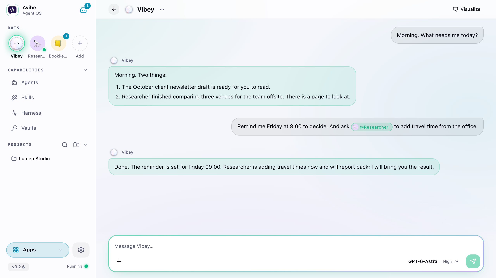
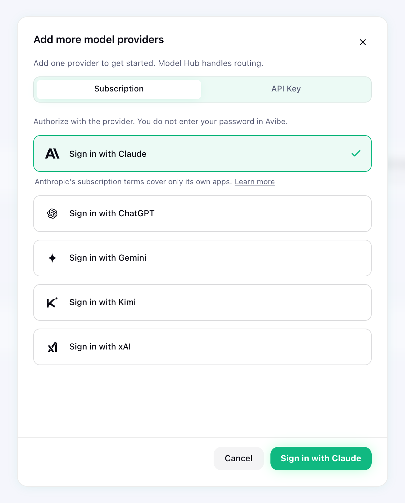
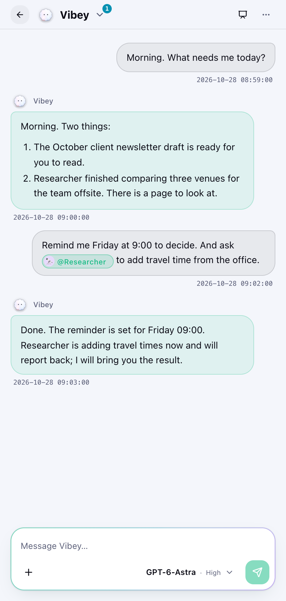
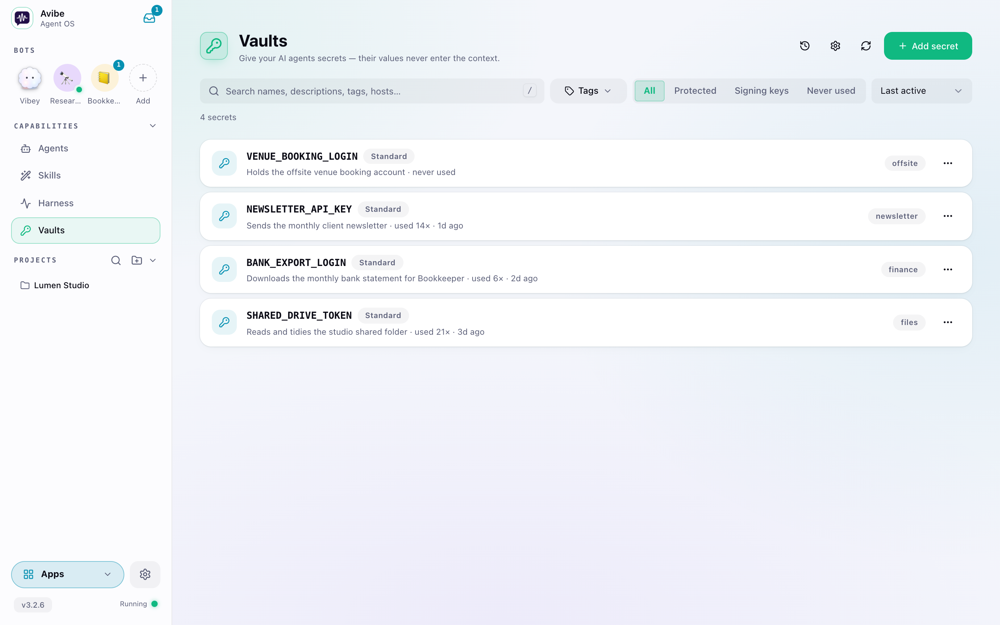
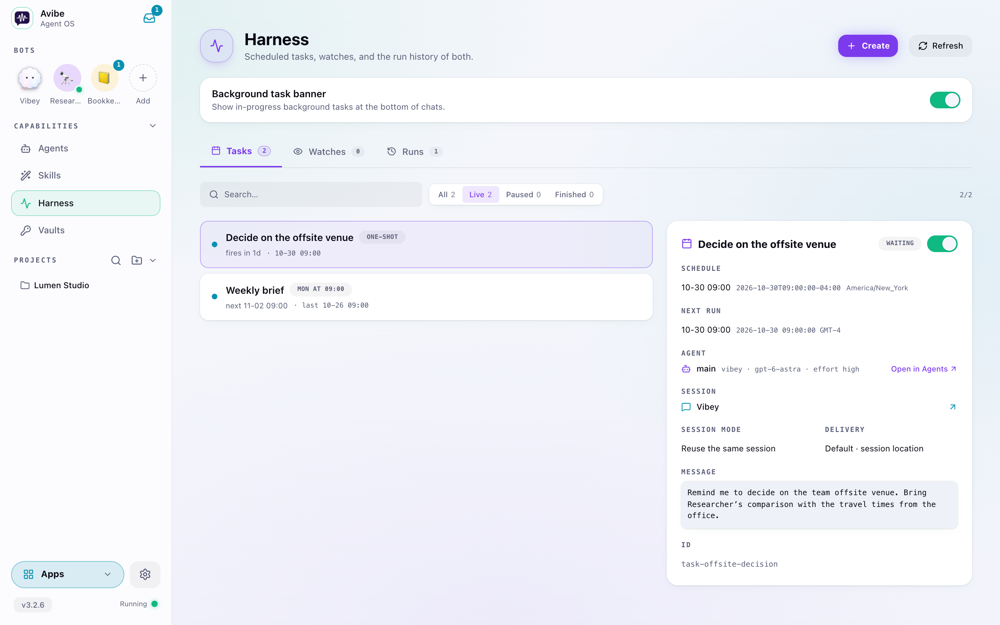

<div align="center">


# Avibe

### Make your computer a home for your AI partner.

Avibe is the local-first Agent OS: it runs on your own Mac or PC. Vibey, its built-in AI partner, lives there. It remembers what you are working on, does the work on your machine, and comes to find you when it is done or needs a decision.<br/>
Reach it from the desktop app, your iPhone, or the chat app you already have open.

**[Download for Mac](#mac)** · **[Download for Windows](#windows)** · **[iPhone](#iphone)** · **[Linux and servers](#linux-and-servers)**

[](https://github.com/avibe-bot/avibe/releases/latest)
[](LICENSE)
[](https://github.com/avibe-bot/avibe)

[Website](https://avibe.bot) · [Docs](https://docs.avibe.bot) · [English](README.md) · [中文](README_ZH.md)

</div>

<br/>



<p align="center"><sub>The Avibe Workbench, with sample data</sub></p>

Avibe is free and open source. It runs on the Claude or ChatGPT subscription you already pay for, or on an API key.

## What you can ask it

Say it the way you would say it to a person.

- **"Compare three venues for our October offsite and show me a page I can share."** Vibey searches the web and answers with a live page, not a wall of text. Open it on your phone, point at the part you want changed, and it reworks the page.
- **"Every Monday at 9, tell me what changed in this folder last week."** It sets the schedule itself and reports in the same conversation each week.
- **"Sort these invoices into folders by month, and tell me what you moved."** It works with the real files on your computer and tells you what it did.
- **"Keep an eye on this page and tell me when it changes."** It waits in the background and comes back when there is something to say. You do not have to keep a window open.
- **"Upload this with my site login."** The password stays in your Vault. Vibey asks for it by name, and Avibe hands it straight to the upload without showing it to Vibey.
- **"Have Claude Code build this, have Codex review it, and tell me when it is ready."** If you write software, Vibey hands the parts to the coding agents you already use and brings back the result.

Avibe runs on your computer, so the work continues for as long as that computer is on.

## Get Avibe

### Mac

1. **Download** Avibe from [avibe.bot](https://avibe.bot/#download). Direct links: [Apple silicon](https://dl.avibe.bot/latest/Avibe_aarch64-apple-darwin.dmg) · [Intel](https://dl.avibe.bot/latest/Avibe_x86_64-apple-darwin.dmg).
2. **Open** the download, drag Avibe to Applications, and start it.
3. **Connect a model.** Sign in with your Claude or ChatGPT subscription, or paste an API key, pick a model for Vibey, and say hello.

The app is signed and notarized by Apple, needs nothing else installed, and checks for its own updates.

### Windows

1. **Download** Avibe from [avibe.bot](https://avibe.bot/#download). Direct link: [Windows x64](https://dl.avibe.bot/latest/Avibe_x86_64-pc-windows-msvc.exe).
2. **Run** the installer, then start Avibe.
3. **Connect a model.** Sign in with your Claude or ChatGPT subscription, or paste an API key, pick a model for Vibey, and say hello.

The installer is signed, and Windows may ask you to confirm the first time you run it. The app needs nothing else installed and checks for its own updates.

On both, step 3 is one sign-in:

<p align="center"></p>

### iPhone

The iPhone app is your Avibe in your pocket: the same conversations, and a notification when something needs you. It connects to the Avibe on your computer. It does not run on its own.

1. **On your computer,** sign in when setup finishes, or later from the bottom of the sidebar. All it takes is an email address. Signing in adds the computer to your account and turns on remote access.
2. **On your iPhone,** install [TestFlight](https://apps.apple.com/us/app/testflight/id899247664), then open the [Avibe beta invitation](https://testflight.apple.com/join/HXqwMqeX). The app is listed as **Avibe OS** and needs iOS 17 or later.
3. **Sign in** with the same email and pick your computer.

The iPhone app is a public beta.

### Linux and servers

```bash
curl -fsSL https://avibe.bot/install.sh | bash
vibe
```

`vibe` starts Avibe and opens setup in your browser. On a machine with no screen, run `vibe remote` to pair it with your avibe.bot account and open it from another device. The script is open source: read [install.sh](https://github.com/avibe-bot/avibe/blob/master/install.sh) first if you like. More in the [install guide](https://docs.avibe.bot/get-started/install).

<details>
<summary>Prefer the command line on Windows or macOS?</summary>

The same `vibe` command-line install works on macOS with the command above. On Windows, run this in PowerShell:

```powershell
irm https://avibe.bot/install.ps1 | iex
```

The Desktop App is the recommended way to run Avibe on both.
</details>

## Your Bots


**Vibey** is your main Bot. It is built in, it is the first one you talk to, and it can see everything on your Avibe.

A Bot is a standing member of your Avibe, not a chat you start over each time. It has a name, a role, a memory of its own, and one conversation that never ends. Add a Researcher or a Bookkeeper when an area deserves one; you can have up to five besides Vibey.

You talk things through with a Bot and decide together. The Bot hands the work to **Agents**, which do the job in their own sessions, several at once if needed. It follows each job to the end and comes back with the result.

On long work, Vibey keeps hold of what you asked for and why. In our own benchmark on a GPT model, after its memory had been condensed eight or more times it still answered what the task was, what the rules were, and what came next 97% of the time. The benchmark is internal and AI-judged. [How Vibey remembers](https://docs.avibe.bot/agents/vibey-memory) · [The benchmark and its limits](https://docs.avibe.bot/agents/vibey-memory-benchmark)

<br clear="all"/>

## With you wherever you are



- **iPhone.** The [iPhone app](#iphone) opens the same conversations and notifies you when a job finishes or needs a decision.
- **Any browser.** Once you sign in, your Avibe gets its own address at avibe.bot. Only the people you allow can sign in; by default, that is you.
- **Chat apps.** Connect Slack, Discord, Telegram, WeChat, or Lark / Feishu, and message your Bots where you already talk to people.
- **On your desktop.** In the Desktop App, Vibey keeps a small window on screen. Type to it, or hold it and speak.

Wherever you reach it from, it is the same Avibe on the same computer.

<br clear="all"/>

## What is inside

### Workbench

Your conversations, files, a terminal, and an editor, as windows side by side in one place. The pages and small apps your Bots build open right next to them.

### Model Hub: the plans you already pay for

Sign in with a Claude or ChatGPT subscription, or add API keys, and every Bot and Agent can use them. Line up more than one, and when a plan hits its limit the next takes over. Model Hub also shows how much of each plan you have used.

### Vault: secrets by name, not by value

Save a password, API key, or signing key once. Agents ask for it by name. Avibe does not show them the value: it hands it straight to the command or request that needs it. A signing key never leaves the Vault; only the signature comes back. You can make any secret ask you before each use.



### Show Pages

Ask for a comparison, a dashboard, a report, or a small tool and get a live page. Point at any part of it and say what to change. Keep it private, share it with people you choose, or publish it at a link.

### Scheduled and background work

Bots set their own reminders and schedules, wait for things to happen, and keep working in the background. Everything they have set up is listed in one place.



### Skills and MCP

Teach your Agents a way of working once, as a Skill, and all of them follow it. Connect an MCP server once, and all of them can use its tools.

### Computer Use (macOS)

On a Mac, with Computer Use turned on in the Desktop App, Agents can see and operate the apps on your desktop. It is off until you turn it on, and it is available on macOS only.

## Yours, on your machine

- Your files, your keys, and the Agents themselves stay on your computer.
- What an Agent needs for a job goes to the AI provider you chose.
- avibe.bot signs you in and opens a secure tunnel to your computer. Your workspace does not pass through it.
- Two things do pass through avibe.bot: voice input, which is transcribed there, and iPhone notifications, which are encrypted on your computer before they leave it.

The docs list [every path that carries your content](https://docs.avibe.bot/concepts/local-first#what-leaves-your-machine).

## FAQ

<details>
<summary><b>Does it cost anything?</b></summary>

Avibe is open source (MIT) and free. You bring your own subscription or API key and pay that provider directly. There is no markup and no second subscription.
</details>

<details>
<summary><b>Can I use my Claude or ChatGPT subscription?</b></summary>

Yes. Sign in during setup or later in Model Hub. Each vendor's terms still apply, and Avibe tells you before a sign-in that may carry account restrictions. See [Model Hub](https://docs.avibe.bot/concepts/model-hub).
</details>

<details>
<summary><b>Do I need an avibe.bot account?</b></summary>

No. Avibe works on your computer without one. Sign in when you want to reach it from your phone or another computer.
</details>

<details>
<summary><b>Does my computer have to stay on?</b></summary>

Yes. Avibe and your Agents run on your computer, so scheduled and background work continues while it is on. Closing the Avibe window does not stop it.
</details>

<details>
<summary><b>Is remote access safe?</b></summary>

Your computer dials out to open the tunnel; no port is opened to the internet. Apart from Show Pages you choose to publish, nothing is reachable without signing in, and only the people you allow can sign in. If something is misconfigured, access is refused, not opened. See [Remote access](https://docs.avibe.bot/concepts/remote-ui).
</details>

<details>
<summary><b>Does it run local models?</b></summary>

Local-first here means your files and the work stay on your machine, not necessarily the model. If you want the model local too, point Model Hub at any compatible endpoint you host.
</details>

<details>
<summary><b>Do I need Claude Code, Codex, or OpenCode?</b></summary>

No. Vibey is built in. The coding agents are optional, and setup can install the ones you choose.
</details>

## For developers

**Bring your coding agents.** The official Claude Code, Codex, and OpenCode CLIs run unchanged next to Vibey, each with its own model and reasoning effort. Vibey can hand them work, and **Runs** draws who started which session and where it reports back. Setup detects the ones you have and installs the ones you pick.

**Instruction files.** Vibey loads `~/.avibe/AGENTS.md`, then each `AGENTS.md` (or `CLAUDE.md`) from the filesystem root down to the working directory, at the start of every turn. See [Vibey](https://docs.avibe.bot/agents/vibey).

**Commands.**

```bash
vibe            # Start Avibe and open the Workbench
vibe status     # Check the service and its configuration
vibe stop       # Stop the local service
vibe upgrade    # Upgrade a command-line install
vibe doctor     # Diagnose setup problems; "vibe doctor repair" applies safe fixes
vibe remote     # Pair with avibe.bot and manage remote access
vibe agent      # Run and manage Agents
vibe task       # Schedule work
vibe watch      # Wait on a condition, then act
vibe runs       # Inspect run history
vibe show       # Create and publish Show Pages
vibe vault      # Manage secrets, authenticated requests, and signing
vibe mcp        # Call the tools of connected MCP servers
```

**Uninstall.** In the Desktop App, choose **Uninstall Avibe…** in the app's menu, then delete the app (macOS) or run the Windows uninstaller. For a command-line install, run the installer with `--uninstall`:

```bash
bash -o pipefail -c 'curl -fsSL https://avibe.bot/install.sh | bash -s -- --uninstall'
```

Both keep your data in `~/.avibe`. To delete your data too, add `--purge`. It lists what it will delete and asks first; **deleted data cannot be recovered**:

```bash
bash -o pipefail -c 'curl -fsSL https://avibe.bot/install.sh | bash -s -- --uninstall --purge'
```

More in the [install guide](https://docs.avibe.bot/get-started/install#uninstall).

**Read more.** [Quickstart](https://docs.avibe.bot/quickstart) · [What is Avibe](https://docs.avibe.bot/concepts/agent-os) · [Bots](https://docs.avibe.bot/concepts/bots) · [Model Hub](https://docs.avibe.bot/concepts/model-hub) · [Vaults](https://docs.avibe.bot/concepts/vaults) · [Show Pages](https://docs.avibe.bot/concepts/show-pages) · [Skills](https://docs.avibe.bot/concepts/skills) · [Harness](https://docs.avibe.bot/concepts/harness) · [CLI reference](docs/CLI.md) · [Chat commands](docs/COMMANDS.md) · [MCP Hub](docs/MCP_HUB.md) · [Install with an AI agent](docs/INSTALL_FOR_AI.md) · [Security policy](SECURITY.md)

> **Built with Avibe.** This project is developed end to end with Avibe itself, from the desk and from a phone. — [@alex_metacraft](https://x.com/alex_metacraft)

---

<div align="center">

**Your computer. Your AI partner. Within reach, wherever you are.**

[Download](https://avibe.bot/#download) · [Docs](https://docs.avibe.bot) · [Report a bug](https://github.com/avibe-bot/avibe/issues)

</div>
