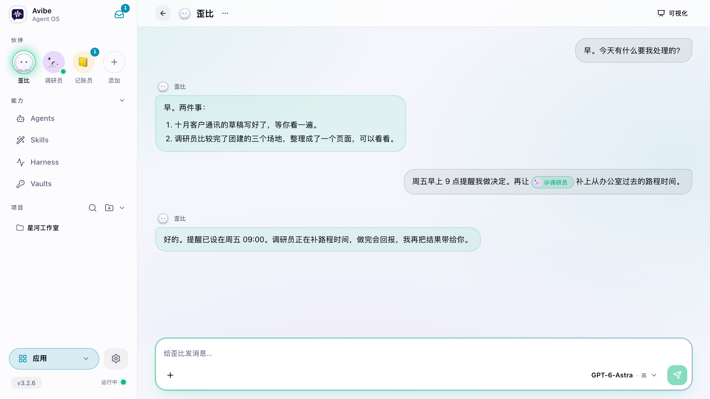
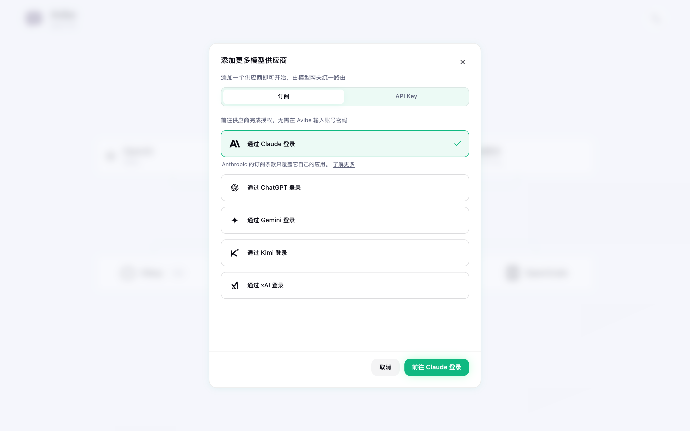
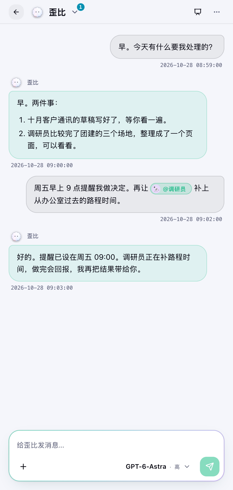
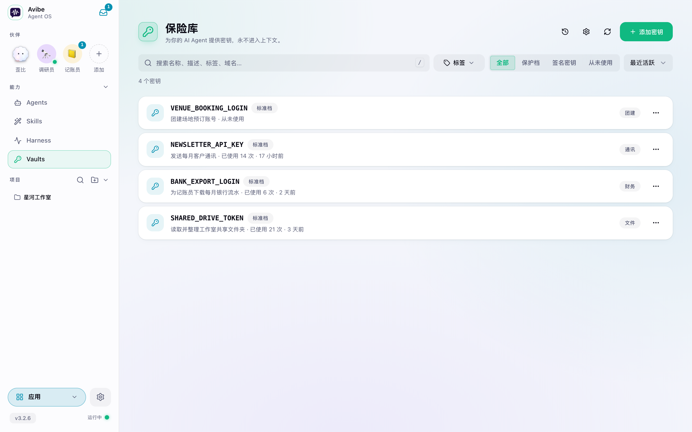
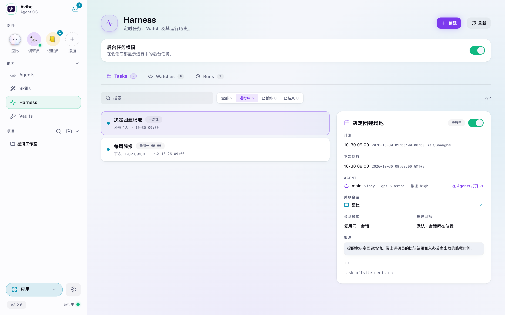

<div align="center">


# Avibe

### 让你的电脑，成为 AI 伙伴的家。

Avibe 是本地优先的 Agent OS，跑在你自己的 Mac 或 Windows 电脑上。内置的 AI 伙伴歪比（Vibey）就住在里面：它记得你在忙什么，活儿在你自己的电脑上干，干完了、或者要你拿主意的时候，会来找你。<br/>
坐在电脑前用桌面 App，出门用 iPhone，也可以直接在常用的聊天软件里叫它。

**[下载 Mac 版](#mac)** · **[下载 Windows 版](#windows)** · **[iPhone](#iphone)** · **[Linux 与服务器](#linux-与服务器)**

[](https://github.com/avibe-bot/avibe/releases/latest)
[](LICENSE)
[](https://github.com/avibe-bot/avibe)

[官网](https://avibe.bot/?lang=zh) · [文档](https://docs.avibe.bot/zh) · [English](README.md) · [中文](README_ZH.md)

</div>

<br/>



<p align="center"><sub>Avibe 工作台，示例数据</sub></p>

Avibe 免费、开源。用你已经在付费的 Claude 或 ChatGPT 订阅就能跑，填一个 API Key 也行。

## 可以让它做什么

像跟人说话一样说就行。

- **“比一比十月团建的三个场地，做成一页我能转给大家看的。”** 歪比自己上网查，给你的不是一大段字，而是一个能打开的页面。手机上也能看，指着哪里说要改，它就改哪里。
- **“每周一早上九点，告诉我这个文件夹上周有什么变动。”** 时间它自己定好，每周在同一个对话里向你汇报。
- **“把这些发票按月份分到文件夹里，再告诉我你动了哪些。”** 它处理的是你电脑上真实的文件，做完会说清楚做了什么。
- **“帮我盯着这个网页，有变化了告诉我。”** 它在后台等着，有情况才回来找你，你不用一直开着窗口。
- **“用我的网站账号把这个传上去。”** 密码一直在你的 Vault 里。歪比只报出它的名字，Avibe 把密码直接交给上传这一步，不给歪比看。
- **“让 Claude Code 来写，Codex 来审，弄好了叫我。”** 如果你写代码，歪比会把活儿分给你已经在用的编码 Agent，再把结果带回来。

Avibe 跑在你的电脑上，所以电脑开着，活儿就一直在干。

## 安装

### Mac

1. **下载。** 到 [avibe.bot](https://avibe.bot/?lang=zh#download) 下载 Avibe。直接下载：[Apple 芯片](https://dl.avibe.bot/latest/Avibe_aarch64-apple-darwin.dmg) · [Intel 芯片](https://dl.avibe.bot/latest/Avibe_x86_64-apple-darwin.dmg)。
2. **打开。** 打开下载好的文件，把 Avibe 拖进“应用程序”，然后启动它。
3. **接上模型。** 用你的 Claude 或 ChatGPT 订阅登录，或者填一个 API Key，给歪比选一个模型，就可以打招呼了。

App 由 Apple 签名并公证，不用另外装任何东西，有新版本会自己检查。

### Windows

1. **下载。** 到 [avibe.bot](https://avibe.bot/?lang=zh#download) 下载 Avibe。直接下载：[Windows x64](https://dl.avibe.bot/latest/Avibe_x86_64-pc-windows-msvc.exe)。
2. **安装。** 运行安装程序，然后启动 Avibe。
3. **接上模型。** 用你的 Claude 或 ChatGPT 订阅登录，或者填一个 API Key，给歪比选一个模型，就可以打招呼了。

安装程序带有代码签名，第一次运行时 Windows 可能会请你确认。App 不用另外装任何东西，有新版本会自己检查。

两个系统上，第 3 步都只是登录一次：

<p align="center"></p>

### iPhone

iPhone App 就是装在口袋里的 Avibe：同样的对话，有事需要你的时候会发通知。它连接的是你电脑上的 Avibe，自己并不能单独运行。

1. **在电脑上，** 设置完成时登录，或者之后在侧栏最底部登录，只需要一个邮箱。登录后，这台电脑会加入你的账号，并开启远程访问。
2. **在 iPhone 上，** 先安装 [TestFlight](https://apps.apple.com/cn/app/testflight/id899247664)，再打开 [Avibe 测试邀请](https://testflight.apple.com/join/HXqwMqeX)。App 在 TestFlight 里的名字是 **Avibe OS**，需要 iOS 17 或更高版本。
3. **登录。** 用同一个邮箱登录，选中你的电脑。

iPhone App 目前是公开测试版。

### Linux 与服务器

```bash
bash -o pipefail -c 'curl -fsSL https://avibe.bot/install.sh | bash -s -- --launch'
```

这条命令会装好 `vibe` 命令、启动 Avibe，并在浏览器里打开设置向导。没有屏幕的机器，运行 `vibe remote` 把它和你的 avibe.bot 账号配对，就能从别的设备打开。脚本是开源的，不放心可以先读一遍 [install.sh](https://github.com/avibe-bot/avibe/blob/master/install.sh)。更多说明见[安装指南](https://docs.avibe.bot/zh/get-started/install)。

<details>
<summary>想在 Windows 或 macOS 上用命令行？</summary>

macOS 可以直接用上面的命令安装同一个 `vibe` 命令行。Windows 在 PowerShell 里运行：

```powershell
irm https://avibe.bot/install.ps1 | iex
```

这两个系统上，我们推荐的方式都是桌面 App。
</details>

## 你的伙伴


**歪比（Vibey）** 是你的主伙伴。它是内置的，是你第一个说话的对象，Avibe 里的一切它都看得到。

伙伴是 Avibe 里的常驻成员，不是每次都要从头开始的聊天。它有名字、有分工、有自己的记忆，还有一个永远不会结束的对话。哪块事情值得专人负责，就加一位，比如调研员、记账员；除了歪比，最多可以再加五位。

你和伙伴商量、一起拿主意。活儿由伙伴交给 **Agent** 去做，每个 Agent 在自己的会话里干，需要的话可以好几个同时干。伙伴会一直跟到底，再把结果带回来。

任务一长，歪比照样记得你要什么、为什么要。在我们自己的评测里（GPT 模型），记忆被压缩八次以上之后，“任务是什么、规则是什么、下一步做什么”它仍有 97% 答对。这是内部评测，由 AI 评分。[歪比怎么记事](https://docs.avibe.bot/zh/agents/vibey-memory) · [评测方法与局限](https://docs.avibe.bot/zh/agents/vibey-memory-benchmark)

<br clear="all"/>

## 走到哪都找得到它



- **iPhone。** [iPhone App](#iphone) 里是同样的对话，活儿干完或者需要你决定时会通知你。
- **任意浏览器。** 登录之后，你的 Avibe 在 avibe.bot 上有一个专属地址。只有你允许的人能登录，默认只有你自己。
- **聊天软件。** 接入 Slack、Discord、Telegram、微信或飞书 / Lark，在你平时和人聊天的地方给伙伴发消息。
- **电脑桌面。** 在桌面 App 里，歪比会在屏幕上留一个小窗口。可以打字，也可以按住它直接说话。

不管从哪里找它，都是同一台电脑上的同一个 Avibe。

<br clear="all"/>

## 里面有什么

### 工作台

对话、文件、终端和编辑器，都是一个个窗口，并排放在一起。伙伴做出来的页面和小工具，也在旁边直接打开。

### Model Hub：用你已经在付费的订阅

用 Claude 或 ChatGPT 订阅登录，或者添加 API Key，所有伙伴和 Agent 都能用。可以多接几个排好顺序，一个用到上限，下一个自动顶上。每份订阅用了多少，Model Hub 里也看得到。

### Vault（保险库）：只报名字，不给密钥值

密码、API Key、签名密钥，存一次就行。Agent 用的时候只报名字，Avibe 不会把值给它看，而是直接交给需要它的那条命令或请求。签名密钥始终不离开 Vault，返回的只有签名结果。任何一条密钥都可以设成每次使用前先问你。



### Show Pages

要一份对比、一个仪表盘、一份报告或者一个小工具，拿到的是一个能打开的页面。指着页面上任何一处说怎么改，它就改。可以只给自己看，可以分享给指定的人，也可以发布成一个链接。

### 定时和后台任务

伙伴会自己设提醒、排日程，等某件事发生，在后台接着干。它安排下的所有事情，都列在同一个地方。



### 技能和 MCP

把一套做事的方法教一次，存成技能，所有 Agent 都照着做。MCP 服务接一次，所有 Agent 都能用上它的工具。

### Computer Use（仅 macOS）

在 Mac 上，从桌面 App 里打开 Computer Use 之后，Agent 可以看到并操作你桌面上的应用。默认关闭，你打开才生效；目前只支持 macOS。

## 数据在你自己手里

- 你的文件、密钥，还有 Agent 本身，都留在你的电脑上。
- Agent 干活需要用到的内容，会发给你选定的 AI 服务商。
- avibe.bot 负责登录，并打开一条通向你电脑的安全通道。你的工作区内容不经过它。
- 有两样东西会经过 avibe.bot：语音输入，在那里转成文字；iPhone 通知，离开你的电脑之前就已经加密。

文档里列出了[每一条会带走你内容的网络路径](https://docs.avibe.bot/zh/concepts/local-first)。

## 常见问题

<details>
<summary><b>要花钱吗？</b></summary>

Avibe 开源（MIT）、免费。订阅或 API Key 由你自己带，钱直接付给对应的服务商，不加价，也不用再买一份订阅。
</details>

<details>
<summary><b>能用我的 Claude 或 ChatGPT 订阅吗？</b></summary>

能。设置时登录，或者之后在 Model Hub 里登录。各家服务商自己的条款仍然适用；如果某种登录方式可能带来账号限制，Avibe 会在登录前提醒你。详见 [Model Hub](https://docs.avibe.bot/zh/concepts/model-hub)。
</details>

<details>
<summary><b>一定要注册 avibe.bot 账号吗？</b></summary>

不用。不登录，Avibe 在你的电脑上照常工作。想从手机或另一台电脑访问时再登录。
</details>

<details>
<summary><b>电脑要一直开着吗？</b></summary>

要。Avibe 和 Agent 都跑在你的电脑上，电脑开着，定时任务和后台任务才会继续。关掉 Avibe 的窗口不会让它停下。
</details>

<details>
<summary><b>远程访问安全吗？</b></summary>

通道是你的电脑主动向外连出去的，不会向互联网开放任何端口。除了你主动发布的 Show Page，其他内容都要登录后才能访问，而且只有你允许的人能登录。配置出了问题时，结果是拒绝访问，而不是放行。详见[远程访问](https://docs.avibe.bot/zh/concepts/remote-ui)。
</details>

<details>
<summary><b>能跑本地模型吗？</b></summary>

这里说的“本地优先”，指的是文件和干活的过程留在你的电脑上，不一定包括模型。想让模型也在本地，可以把 Model Hub 指向你自己部署的兼容接口。
</details>

<details>
<summary><b>需要先装 Claude Code、Codex 或 OpenCode 吗？</b></summary>

不需要。歪比是内置的。这几个编码 Agent 是可选的，设置向导可以帮你装上选中的那些。
</details>

## 给开发者

**带上你的编码 Agent。** 官方的 Claude Code、Codex、OpenCode 命令行原样运行，和歪比并排，各自可以设模型和推理强度。歪比能给它们派活，**Runs** 会画出谁启动了哪个会话、结果回报给谁。设置向导会找到你已经装好的，并装上你选中的。

**指令文件。** 每一轮开始时，歪比会先读 `~/.avibe/AGENTS.md`，再从文件系统根目录到工作目录，逐级读取各目录的 `AGENTS.md`（或 `CLAUDE.md`）。详见 [Vibey](https://docs.avibe.bot/zh/agents/vibey)。

**命令。**

```bash
vibe            # 启动 Avibe 并打开工作台
vibe status     # 查看服务和配置状态
vibe stop       # 停止本地服务
vibe upgrade    # 升级命令行安装的 Avibe
vibe doctor     # 诊断设置问题；"vibe doctor repair" 执行安全的修复
vibe remote     # 与 avibe.bot 配对并管理远程访问
vibe agent      # 运行和管理 Agent
vibe task       # 安排定时任务
vibe watch      # 等待某个条件，然后执行
vibe runs       # 查看运行历史
vibe show       # 创建和发布 Show Page
vibe vault      # 管理密钥、带认证的请求和签名
vibe mcp        # 调用已接入 MCP 服务的工具
```

**卸载。** 桌面 App：先在 App 菜单里选择 **卸载 Avibe…**，再删除 App（macOS）或运行 Windows 卸载程序。命令行安装：带上 `--uninstall` 运行安装脚本：

```bash
bash -o pipefail -c 'curl -fsSL https://avibe.bot/install.sh | bash -s -- --uninstall'
```

两种方式都会保留 `~/.avibe` 里的数据。想连数据一起删除，加上 `--purge`。它会先列出要删除的内容并请你确认；**删除的数据无法恢复**：

```bash
bash -o pipefail -c 'curl -fsSL https://avibe.bot/install.sh | bash -s -- --uninstall --purge'
```

更多说明见[安装指南](https://docs.avibe.bot/zh/get-started/install)。

**延伸阅读。** [快速开始](https://docs.avibe.bot/zh/quickstart) · [Avibe 是什么](https://docs.avibe.bot/zh/concepts/agent-os) · [伙伴](https://docs.avibe.bot/zh/concepts/bots) · [Model Hub](https://docs.avibe.bot/zh/concepts/model-hub) · [Vaults](https://docs.avibe.bot/zh/concepts/vaults) · [Show Pages](https://docs.avibe.bot/zh/concepts/show-pages) · [技能](https://docs.avibe.bot/zh/concepts/skills) · [Harness](https://docs.avibe.bot/zh/concepts/harness) · [CLI 参考](docs/CLI_ZH.md) · [聊天命令](docs/COMMANDS_ZH.md) · [MCP Hub](docs/MCP_HUB.md) · [让 AI 帮你安装](docs/INSTALL_FOR_AI_ZH.md) · [安全策略](SECURITY.md)

> **用 Avibe 做出来的 Avibe。** 这个项目从头到尾都是用 Avibe 自己开发的，在工位上，也在手机上。— [@alex_metacraft](https://x.com/alex_metacraft)

---

<div align="center">

**你的电脑，你的 AI 伙伴，走到哪都在手边。**

[下载](https://avibe.bot/?lang=zh#download) · [文档](https://docs.avibe.bot/zh) · [反馈问题](https://github.com/avibe-bot/avibe/issues)

</div>
