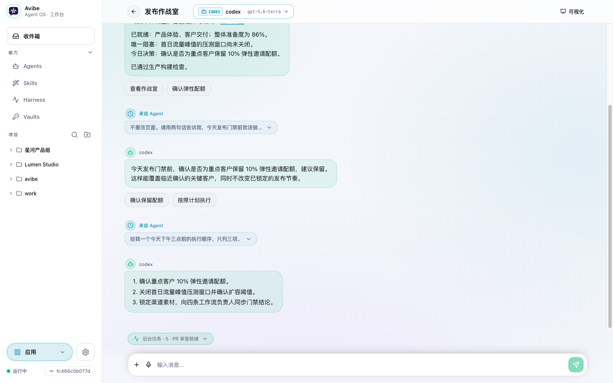
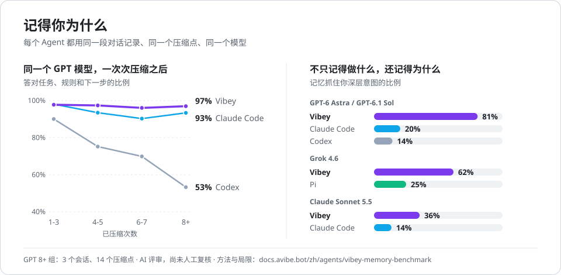
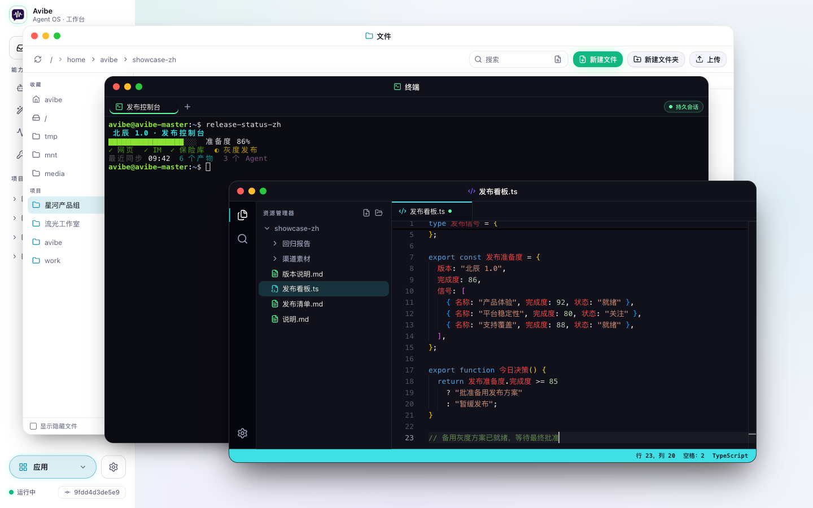
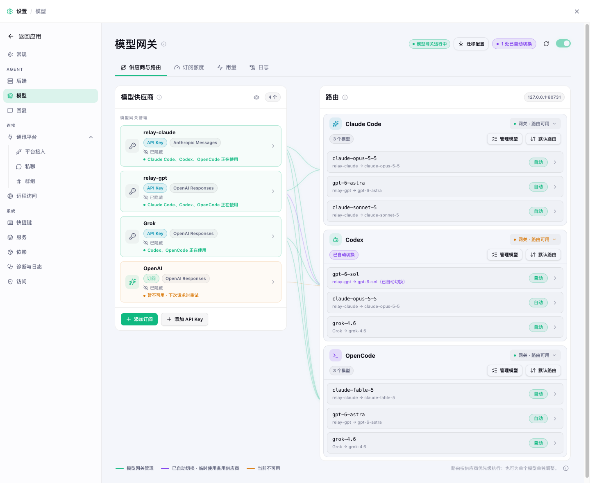
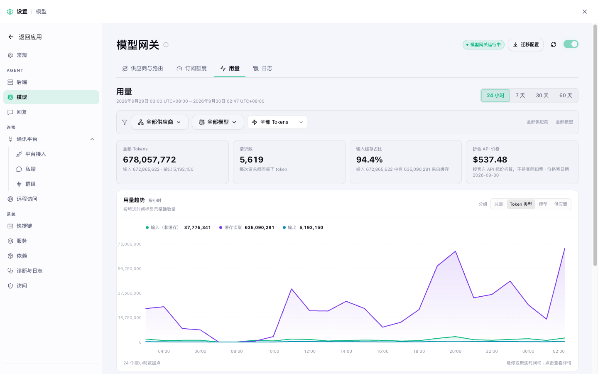
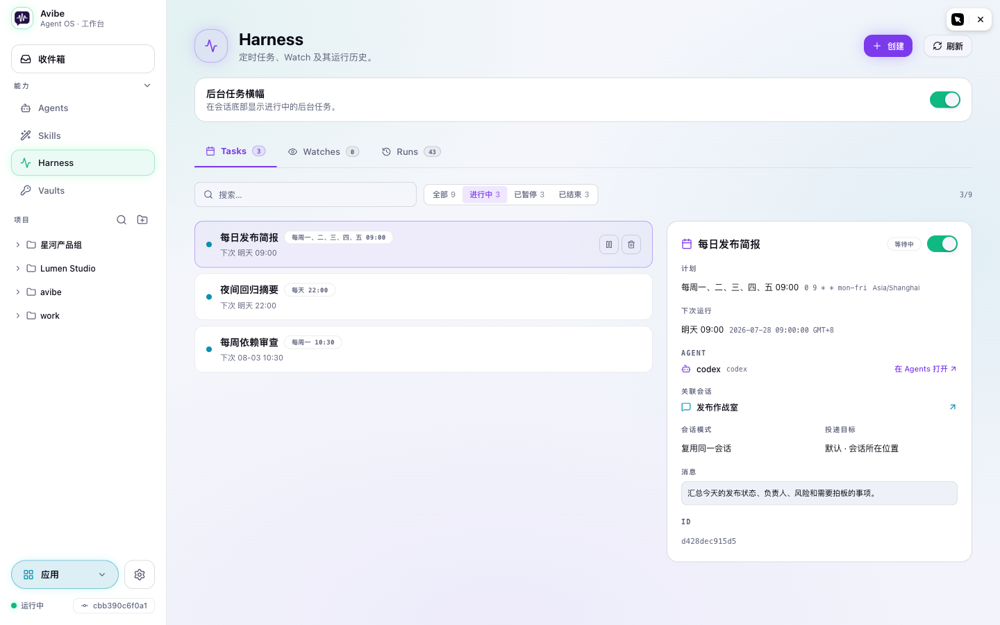
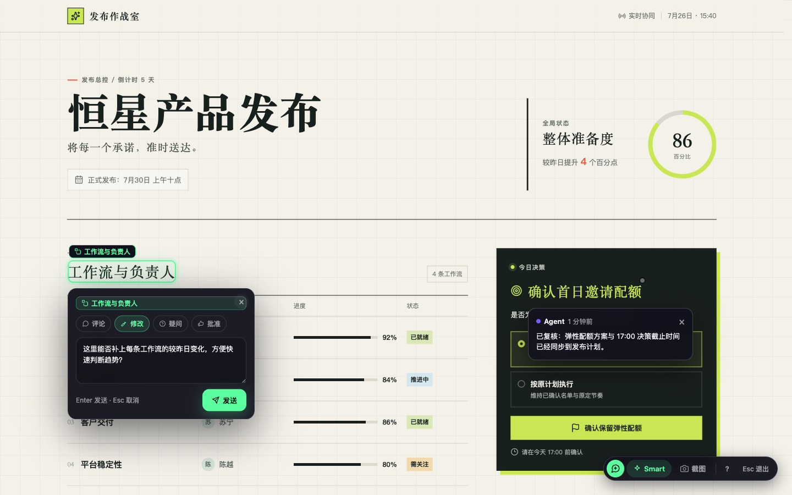
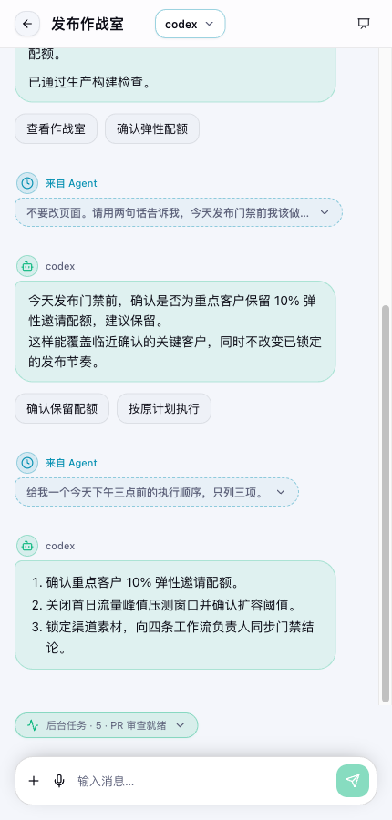
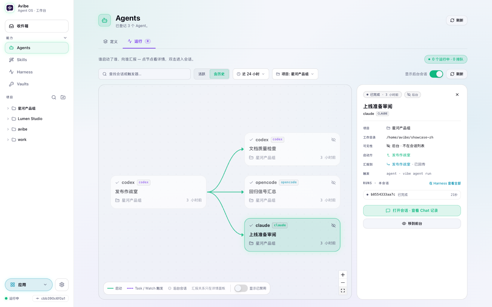

<div align="center">


# Avibe

### 让你的电脑，成为 AI 伙伴的家。

**内置 AI 伙伴 Vibey 开箱即用，Claude Code、Codex、OpenCode 也能一起住进来。**<br/>
Avibe 是本地优先的 Agent OS：工作台、持久任务、Model Hub、Show Pages 和 Vaults，整套系统跑在你自己的机器上，浏览器、手机、聊天软件都能找到它。

[](https://github.com/avibe-bot/avibe/stargazers)
[](https://github.com/avibe-bot/avibe/releases/latest)
[](https://www.python.org/)
[](LICENSE)

[文档](https://docs.avibe.bot/zh) · [English](README.md) · [中文](README_ZH.md)

**Agent**    

**从这些地方找到它**      

</div>

<br/>

<!-- Screenshot slot: workbench-vibey -->


## 开始使用

```bash
bash -o pipefail -c 'curl -fsSL https://avibe.bot/install.sh | bash -s -- --launch'
```

**用你已有的订阅登录，或者填一个 API Key，Vibey 就能开工，不用另装任何 CLI。** 浏览器会自动打开三步设置向导：帮你接好模型、找到你已经在用的 agent（选中的点一下就装上），然后直接把你送进 Workbench。

> 开源——想看可以先读一遍[安装脚本](https://github.com/avibe-bot/avibe/blob/master/install.sh)。短链只是到这个文件的 307 重定向。

<details>
<summary><b>用 Windows？</b></summary>

Windows 上推荐用 WSL，兼容性最好——见 [从零用 WSL 跑 Avibe](docs/WINDOWS_WSL_ZH.md)。里面讲清楚 WSL 装在哪、用哪个终端、在哪运行安装命令、怎么打开 Web UI。
</details>

---

## 认识 Vibey——住在你电脑里的 AI 伙伴


Vibey（歪比）是 Avibe 自己的 Agent：内置、始终开启，不用另外安装。从 Model Hub 给它一个模型，它就能在 Workbench 和你接入的每个聊天软件里开工。

读得懂气氛，会接你昨天没做完的活儿。不确定就先问一句，你专注的时候它不打扰，凌晨两点灵感来了就动手，第二天给你留张便条，说改了哪儿。有自己的脾气。你修了它的 bug，它会道谢。

> Avibe 是那个家，歪比是住在里面的 AI 伙伴。

<br clear="all"/>

### 🧠 记得你为什么

活儿一长，任何 agent 都得一遍遍压缩前面的对话。每一次，Vibey 都围绕真正要紧的东西重新整理记忆：长期目标、你原话里的要求、下一步，还有你为什么要这么做——最后这一点，它比我们测过的其他 agent 记得牢得多。

<picture>
  <source media="(prefers-color-scheme: dark)" srcset="assets/benchmark/vibey-memory-zh-dark.svg">
  
</picture>

- **压缩 8 次以上，仍有 97%。** 同一个 GPT 模型上，Vibey 仍有 97% 能答对任务是什么、规则是什么、下一步做什么。Claude Code 93%，Codex 53%。
- **9 项对比里 8 项最高**（三个模型 × 三项指标）。唯一的例外：在 Claude Code 的原生模型 Claude Sonnet 5.5 上，长期目标 99% 对 96%；同一模型上，Vibey 留住了更多你的要求（89% 对 78%）。
- **不只记得做什么，还记得为什么。** 记忆抓住你的深层意图：Vibey 81%，Claude Code 20%、Codex 14%（GPT）；62% 对 Pi 25%（Grok）；36% 对 Claude Code 14%（Sonnet）。

<sub>Avibe 内部评测，基于 6 个真实长会话、55 个压缩点；每个 agent 都用同一份对话记录、同一个压缩点、同一个模型。由 AI 评审，尚未人工复核；完整方法和局限见文档。</sub>

→ [Vibey 怎么记事](https://docs.avibe.bot/zh/agents/vibey-memory) · [记忆评测](https://docs.avibe.bot/zh/agents/vibey-memory-benchmark)

### ⏰ 有自己的时间线

Vibey 会安排定时任务、用 Watch 等结果、在后台把活儿干完，有值得你看的东西再回到同一个会话找你。说一句 *"盯着这个 PR，有可执行的 review 意见了再回来找我"*，你就可以去忙别的；连它跑的长命令也会转成 Watch，结束后自己回来汇报。→ [Harness](https://docs.avibe.bot/zh/concepts/harness)

### 📱 在哪都找得到它

浏览器里的 Workbench、手机、Slack、Discord、Telegram、微信、飞书——同一个 Vibey，同一台机器。文字说不清的时候，它直接用 Show Page 回答你：一个活的仪表盘、流程图或报告，你可以指着它提意见。→ [Show Pages](https://docs.avibe.bot/zh/concepts/show-pages)

在 Avibe 桌面 app（测试中）里，Vibey 还会在桌面上留一个小窗：按住它说话，卡片上就能看到它在做什么，包括它发起的后台运行、Watch 和定时任务。

<!-- Screenshot slot: vibey-mini (not delivered yet; text only until then) -->

这三点底下，是实打实的动手能力。Vibey 会读、写、改文件，运行命令（macOS 和 Linux 上用 `bash`，原生 Windows 上用 PowerShell），互不依赖的工具调用同时运行；还能把一件事的不同部分交给 Claude Code、Codex 或 OpenCode。→ [Vibey 文档](https://docs.avibe.bot/zh/agents/vibey)

---

## Vibey 住的这套 OS

大多数 AI 工具，还困在一个窗口里：

- 🖥️ **窗口一关，活儿就停。** 你盯着它才跑。
- 📵 **离开工位，就失联。** 它在干什么你看不到，更别提指挥它。
- 💸 **付着好几份订阅，却卡在一份额度上。** 一个套餐干到一半撞墙，另一个在吃灰。
- 🔒 **它的云，你的数据。** 每个工具都要你装它的 app、买它的订阅，再把你的文件放到别人的服务器上。

Avibe 用 OS 里的一个个部件逐条解决，你带来的每个 agent 也都用同一套部件。代码、密钥和 agent 进程都留在你的机器上——`avibe.bot` 负责登录和安全隧道，从不碰你的工作区。

### 💬 Workbench——不是聊天框，是一张桌面

文件、编辑器、终端开成窗口，和对话并排摆在同一个浏览器标签页里；agent 做出来的应用和 Show Page 就开在旁边。用着用着你会忘了这是网页——它更像一个操作系统。

<!-- Screenshot slot: apps-library -->


### 🔀 Model Hub——你付费的每一份订阅，组成一支队

你的 Claude、ChatGPT、Gemini、Kimi、xAI 订阅，加上各家 API Key——官方厂商、中转站、聚合平台、自建服务——统统汇进同一个本地网关。

- **配一次，所有 Agent 都能用。** 一次登录、一个 Key，Vibey、Claude Code、Codex、OpenCode 同时取用。（留给 CLI 自己管理的订阅，只供那个 CLI 用。）
- **模型随便混搭。** 在 Claude Code 里用 GPT，在 Codex 里用 Claude：协议差异由网关负责转换。
- **额度见底？下一个已经接上了。** 某个来源在开始回答前撞上额度、限流或网络故障，路由里的下一个来源直接接手这次请求。首选来源恢复后，下一轮对话自动切回去。
- **一键搬家。** 已经在支持的 CLI 里登录过？你点头，登录就迁过来。凭据和路由都留在你的机器上。

<!-- Screenshot slot: model-hub-routes -->


**每份套餐值多少，一清二楚。** 按模型和来源看用量，按官方 API 价格折成钱；Claude 和 ChatGPT 订阅还能实时盯住 5 小时和每周额度。*维护者机器上真实的一天：24 小时约 6.8 亿 token，按官方 API 价格折合约 $540。*

<!-- Screenshot slot: model-hub-usage -->


**Vibey 的工具。** 网页搜索和网页读取开箱即用：搜索有内置、免 Key 的 Exa（免费）兜底，网页读取先在你自己的机器上尝试。在**模型 > 工具**里，可以添加 Tavily、Exa 或 DeepSeek 作为搜索服务、排好顺序，或者关掉某个工具；X 搜索和图片生成由支持它们的来源执行。

<!-- Screenshot slot: model-hub-tools (not delivered yet; text only until then) -->

### ⏰ Harness——你睡觉，它上班

四个持久化基础能力——**运行、定时、监听、查历史**——让 agent 能自己开工、等准时机、在后台接着干，有值得你看的东西再回来找你。定时 shell 命令成功时一声不吭，失败时留下一条通知——你开启的话，也能直接交给 Agent 处理。不用背参数，直接说：

- *"每个工作日早上跑一次部署检查，把总结发到这里。"*
- *"为这个故障单独开个调查会话，结论汇报回这个频道。"*
- *"CI 挂了就总结日志；过了就告诉我这个 PR 能不能合。"*

<!-- Screenshot slot: harness-tasks -->


### 🎨 Show Pages——能指着说的回答

要仪表盘、流程图、diff、报告，还是一个小应用？agent 交给你的是一个活的网页，而不是一大段文字。点一个元素、框一块区域、在截图上标几条批注，说一句你想要什么，agent 就改页面，或者就在你指的地方回答。页面可以私有，可以只分享给指定的人，也可以发布成一个好记的链接；常用的固定到应用栏，点开就是一个 app。

<!-- Screenshot slot: show-page -->


### 📱 手机和聊天软件——人离开工位，伙伴照样在手

<!-- Screenshot slot: workbench-vibey-mobile -->


活儿在你的机器上跑，你不用守着它。想开窗口就用 Workbench；想快就在 Slack、Discord、Telegram、微信或飞书里发一条消息——连到的是同一批 Agent、同一台机器。

- 🔔 **需要你时，它会拍拍你。** 把 Workbench 装成手机或桌面 app，任务需要你的那一刻就收到推送。
- 🎙️ **动嘴，不动手。** 和 `avibe.bot` 配对后，实时语音输入边说边出字，说完自动就地整理干净。桌面上按 ⌥Z（Windows 和 Linux 上是 Alt+Z）。
- 🌍 **你专属的 `you-app.avibe.bot`。** `vibe remote` 配对一次，你的 Workbench 在任何地方、任何浏览器里都能打开——不用 VPN，不用端口转发。
- 🔒 **你的门，你定名单。** 只有你的访问策略允许的人能登录——默认只有你自己。认证、路由、主机校验全部默认拒绝。

<br clear="all"/>

### 🔐 Vaults——按名字用密钥，永远不碰密钥值

API Key 或 token 添加一次——缺了哪个，Agent 也能发请求让你在浏览器里补上。Agent 按名字取用，Avibe 把它递给需要它的命令、认证请求或签名操作。Vault 的响应永远不包含密钥值；接收密钥的命令仍需避免把它打印出来。passkey 保护托管在 sandbox 完整性门禁落地前仍未上线。

<!-- Screenshot slot: vaults (not delivered yet; text only until then) -->

**还有**——thread 即会话，随时接着聊 · agent 需要你拍板时弹按钮和表单 · 丰富的附件，应用内直接预览，音频就地播放 · 键盘快捷键 · 后端一键升级。

---

## 带上你的 Agent 团队

Claude Code、Codex、OpenCode 以官方 CLI 的身份照原样运行——就是你自己会装的那几个——和 Vibey 并肩干活，统一收进一套 Agent 注册表。每个 Agent 单独选模型和推理强度，每个项目、每个频道都交给最合适的专家。Skill 写一次，每个 agent 都用同一种方式加载。

Vibey 能给它们派活：让 Claude Code 写一个改动、Codex 来 review、OpenCode 跑测试，最后由它把结果汇报给你。**Runs** 把整条协作链画成一张图：谁发起了哪个后台会话、结果汇报给谁、每个节点背后的执行历史。

<!-- Screenshot slot: agents-graph -->


设置向导会找到你已经装好的 agent，选中的缺哪个就装哪个；想自己装，见 [Agent](#agent)。

> 💚 **Avibe 是用 Avibe 自己做出来的。** 这个项目从头到尾都是我用 Avibe 开发的——从浏览器、从手机指挥 Claude Code、Codex、OpenCode，在不在电脑前都能无缝衔接。越往后做越快，体验和效率直接拉爆。—— [@alex_metacraft](https://x.com/alex_metacraft)

---

## Avibe 凭什么不同

| | |
|---|---|
| **本地优先，真正归你** | AI 伙伴、它的执行、你的密钥和代码都留在你的机器上。`avibe.bot` 签发身份、提供安全隧道，从不代理你的工作区。 |
| **自带伙伴，也欢迎你的 agent** | Vibey 开箱即用。*官方*的 Claude Code、Codex、OpenCode 在它旁边照原样运行——按任务、按项目、按频道切换，不被任何一家锁死。 |
| **所有订阅，组成一支队** | Model Hub 把你的套餐和 Key 汇进同一个网关，模型可以跨 agent 混搭，自动故障接管，还告诉你每一份到底值多少。 |
| **浏览器和聊天，都是一等公民** | Workbench、手机、Slack、Discord、Telegram、微信、飞书——同一批 agent，同一台机器。 |
| **你选的 agent，就是干活的 agent** | 不管是 Vibey 还是官方 CLI，你选了哪个，跑的就是哪个，中间没有转手层。 |

---

## 它怎么工作

```
  你，在任何地方             你的机器                                你的模型
┌──────────────┐      ┌──────────────────────────────────────┐      ┌──────────────┐
│ Browser      │      │ Avibe                                │      │ Subscriptions│
│ Phone (PWA)  │ ───▶ │   Vibey       ─┐                     │      │ API keys     │
│ Slack        │      │   Claude Code ─┤                     │      │ Relays       │
│ Discord …    │ ◀─── │   Codex       ─┼─▶ Model Hub ────────┼────▶ │ Self-hosted  │
│              │      │   OpenCode    ─┘                     │      │              │
│              │      │   Workbench · Harness · Show Pages   │      │              │
└──────────────┘      └──────────────────────────────────────┘      └──────────────┘
```

1. **你开口**——在浏览器或聊天软件里：*"给设置页加个深色模式。"*
2. **Avibe 路由**到对的 Agent、对的项目。
3. **agent** 读你本地的代码、写代码、把过程流式回传；Vibey 还能把其中一部分交给其他 agent。Vibey 的模型始终来自 Model Hub。CLI agent 在网关模式下也一样，每次调用走哪个来源由 Model Hub 决定；直连模式下，它用自己的登录。
4. **你在同一个界面里 review**，在 thread 里迭代，之后在任何地方接着干。

Avibe 通过 Slack Socket Mode、Discord Gateway、Telegram 长轮询、微信轮询或飞书 WebSocket 主动向外连接——聊天控制不需要任何公网入站端口。agent 的 prompt 只发给你配置的模型来源。

---

## Avibe vs OpenClaw

| | Avibe | OpenClaw |
|---|---|---|
| **上手** | 一条命令 + 网页向导，几分钟搞定。 | Gateway + channels + JSON 配置，准备花一个下午。 |
| **安全** | 本地优先，只用 Socket Mode / WebSocket / 长轮询主动外连，无公网入站端口，攻击面极小。 | Gateway 要暴露端口，组件更多，面更大。 |
| **Agent** | 内置 Vibey，加上官方 Claude Code、Codex、OpenCode CLI；自带订阅和 Key，按任务切换。 | 它自己的助手循环。 |

OpenClaw 是一个常驻的个人助手。Avibe 是 **Agent OS**：它自带 AI 伙伴 Vibey，照原样运行你已经信任的官方 agent，并把它们都留在你的机器上，在你本来就在工作的地方随叫随到。

---

## 常见问题

<details>
<summary><b>需要先装 Claude Code、Codex 或 OpenCode 吗？</b></summary>

不需要。Vibey 是内置的：在 Model Hub 里登录一个订阅或者加一个 API Key，给 Vibey 选好模型，它就能用。Claude Code、Codex、OpenCode 是可选的队友，随时都能加进来。
</details>

<details>
<summary><b>能用我现有的 Claude 或 ChatGPT 订阅吗？</b></summary>

能。把支持的订阅作为网关来源加进 Model Hub，Vibey 和你的其他 agent 就都能用，还有额度追踪、用量分析和自动接管。Claude Code 和 Codex 也可以继续用各自的登录。各厂商的条款依然适用；如果某种登录方式可能带来账号限制，Avibe 会在登录前提醒你。详见 [Model Hub](https://docs.avibe.bot/zh/concepts/model-hub)。
</details>

<details>
<summary><b>能跑本地模型吗？</b></summary>

这里的"本地优先"指你的**代码、数据和执行**留在你的机器上——不一定是模型权重。如果你也想让推理在本地，Model Hub 可以指向任何兼容的自建服务。
</details>

<details>
<summary><b>我的代码和数据会去哪？</b></summary>

代码、密钥和 agent 进程都留在你的机器上。agent 的 prompt 发给你配置的模型来源。`avibe.bot` 负责登录和远程 Web UI 隧道，但不代理你的工作区；例外是语音输入，它会经 `avibe.bot` 做转写。每一条承载你内容的网络路径都列在[边界清单](https://docs.avibe.bot/zh/concepts/local-first#哪些东西会离开你的机器)里。
</details>

<details>
<summary><b>Avibe 要付费吗？</b></summary>

Avibe 开源（MIT），免费运行。你自带订阅或 API Key，直接付给服务商——不加价，也不用再多订一份。
</details>

<details>
<summary><b>支持哪些 agent 和平台？</b></summary>

**Agent：** Avibe 内置的 AI 伙伴 Vibey，加上官方 Claude Code、Codex、OpenCode CLI。**界面：** 内置浏览器 Workbench（可安装到桌面和手机），以及 Slack、Discord、Telegram、微信、飞书。
</details>

<details>
<summary><b>远程访问安全吗？</b></summary>

`vibe remote` 从你的机器上跑一条 Cloudflare 隧道；浏览器流量必须先登录（你主动公开发布的 Show Page 除外），而且只放行你的访问策略允许的人（默认只有你）。认证、路由、主机校验全部 **fail-closed**，聊天控制也不需要任何公网入站端口。
</details>

<details>
<summary><b>Avibe 和 OpenClaw、Hermes 有什么不同？</b></summary>

OpenClaw 是网关式的个人助手，Hermes 是带自我学习循环的 agent；它们各自是一个助手、一套自己的运行时。Avibe 是给 agent 用的操作系统：Workbench、Harness、Model Hub、Show Pages、Vaults 和各个聊天入口，由它运行的每个 agent 共用。它自带 AI 伙伴 Vibey，也在旁边照原样运行官方的 Claude Code、Codex、OpenCode。Vibey 的记忆评测对比的是 Claude Code、Codex 和 Pi，OpenClaw 和 Hermes 不在其中。OpenClaw 的具体对比见上面的[对比表](#avibe-vs-openclaw)。
</details>

---

## 命令

```bash
vibe            # 启动 Avibe 并打开 Workbench
vibe status     # 查看服务和配置状态
vibe stop       # 停止本地服务
vibe upgrade    # 升级到最新版本
vibe doctor     # 诊断常见安装问题；"vibe doctor repair" 执行安全修复
vibe remote     # 通过 avibe.bot 从任意设备访问 Workbench
vibe agent      # 运行和管理 Avibe agent
vibe task       # 安排定时工作（cron / 一次性）
vibe watch      # 等一个条件成立，然后行动
vibe runs       # 查看 agent 运行历史
vibe show       # 创建、查看和发布 Show Page
vibe vault      # 管理密钥、请求、认证请求与签名
```

| 在聊天里 | 作用 |
|---|---|
| @ 一下 bot | 开一个任务或提问 |
| 在 thread 里回复 | 继续同一个 agent 会话 |
| `/stop` | 中断当前执行 |

完整参考：[命令](docs/COMMANDS_ZH.md) · [CLI](docs/CLI_ZH.md)

---

## Agent

**Vibey 会读你的说明文件。** 和 Claude Code、Codex 一样，Vibey 在每个 Turn 开始时加载你的常驻说明：
1. `~/.avibe/AGENTS.md`，对所有项目生效；
2. 再从文件系统根目录一路到工作目录，读每一层的 `AGENTS.md`（或 `CLAUDE.md`）。

`AGENTS.override.md` 会替代所在目录的 `AGENTS.md`。几份文件冲突时，越具体的那份为准。工作目录下面子目录里的说明文件不会预先加载：Vibey 会被告知，处理某个子目录里的文件前，先读那个子目录的说明文件。改了文件，下一个 Turn 就生效。这部分说明合计上限 64 KiB；超出时，Vibey 会被告知哪份被截断或没有加载。

设置向导会检测你机器上的 Claude Code、Codex 和 OpenCode，缺哪个、你选了哪个，就帮你装上。想自己装的话：

<details>
<summary><b>Claude Code</b></summary>

```bash
bash -o pipefail -c 'curl -fsSL https://claude.ai/install.sh | bash'
```
</details>

<details>
<summary><b>Codex</b></summary>

```bash
npm install -g @openai/codex
```
</details>

<details>
<summary><b>OpenCode</b></summary>

```bash
bash -o pipefail -c 'curl -fsSL https://opencode.ai/install | bash'
```

除非 `~/.config/opencode/opencode.json` 放行工具调用，否则 OpenCode 可能会停下来等你审批；设置向导可以帮你写好：

```json
{ "permission": "allow" }
```
</details>

---

## 安全

- **本地优先**——Avibe 跑在你的机器上，代码和 agent 进程都留在那。
- **无公网入站端口**——聊天控制只用 Socket Mode / WebSocket / 长轮询。
- **你的密钥，你的数据**——存放在 `~/.avibe/`；agent 的 prompt 只发给你配置的模型来源。已有安装会保留 `~/.vibe_remote/` 作为兼容路径。
- **远程访问默认拒绝**——`avibe.bot` 负责身份和隧道，从不经手你的工作区。

---

## 卸载

带上 `--uninstall` 运行安装脚本。它会先停止 Avibe，再删除它在这台机器上装的所有 `vibe` 命令和安装文件；不是它装的 `vibe` 不会动。`~/.avibe` 里的设置、会话和其他数据都会保留：

```bash
bash -o pipefail -c 'curl -fsSL https://avibe.bot/install.sh | bash -s -- --uninstall'
```

如果连数据也要删，加上 `--purge`。它会先列出要删除的全部内容，确认后才删。**删除的数据无法恢复。** 没有终端可以回答确认时，还需要加 `--yes`。

```bash
bash -o pipefail -c 'curl -fsSL https://avibe.bot/install.sh | bash -s -- --uninstall --purge'
```

---

## 路线图

接下来要做的：

- **原生桌面 app**——带签名自动更新的 macOS 和 Windows 版本正在测试中。
- **更深入的交互式工作流**——在 Chat、应用与 Show Page 之间加入更多直接操作、结构化决策和原位协作。
- **保护档 Vault 托管**——完成不可变 sandbox 完整性门禁后，再向真实用户开放 passkey 保护的密钥。
- **SaaS 模式**——一键托管上手 + 云端中继，而执行依然留在你自己的机器上。

近期已上线：Vibey 的长任务记忆 · Avibe 内置的 AI 伙伴 Vibey · 支持自动接管、额度追踪和用量分析的 Model Hub · 实时语音输入 · Show Page 分享 · 所有后端统一的 Skills · 三步设置向导 · Agent Harness 与运行关系图 · 多窗口应用 · 标准档 Vaults。

---

## 文档

- **[官方文档](https://docs.avibe.bot/zh)**——快速上手、概念、平台与 agent 指南、排障
- **[Avibe 是什么](https://docs.avibe.bot/zh/concepts/agent-os)**——Agent OS 模型
- **[Vibey](https://docs.avibe.bot/zh/agents/vibey)**——Avibe 内置的 AI 伙伴
- **[Vibey 怎么记事](https://docs.avibe.bot/zh/agents/vibey-memory)** · **[Vibey 记忆评测](https://docs.avibe.bot/zh/agents/vibey-memory-benchmark)**——长任务记忆的设计，以及它是怎么测的
- **[Model Hub](https://docs.avibe.bot/zh/concepts/model-hub)**——来源、路由、自动接管、用量与额度
- **[CLI 参考](docs/CLI_ZH.md)** · **[命令](docs/COMMANDS_ZH.md)** · **[Show Pages](docs/SHOW_PAGES.md)**
- **[让 AI agent 帮你装](docs/INSTALL_FOR_AI_ZH.md)**——把它丢给 Claude Code、Codex 或 OpenCode，引导式安装
- **[Slack](docs/SLACK_SETUP_ZH.md)** · **[Discord](docs/DISCORD_SETUP_ZH.md)** · **[Telegram](docs/TELEGRAM_SETUP_ZH.md)** 设置指南

---

<div align="center">

**你的电脑，你的 AI 伙伴。走到哪，都找得到它。**

[立即安装](#开始使用) · [文档](https://docs.avibe.bot/zh) · [报 bug](https://github.com/avibe-bot/avibe/issues) · [关注 @alex_metacraft](https://x.com/alex_metacraft)

</div>
