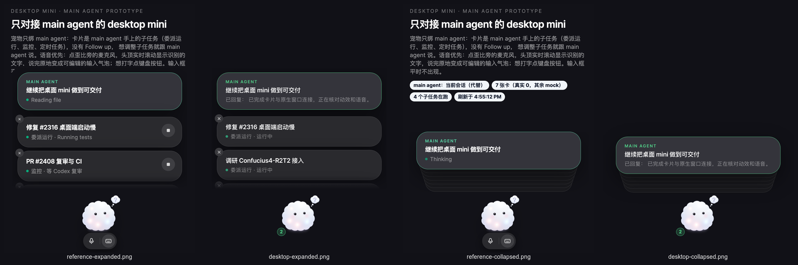
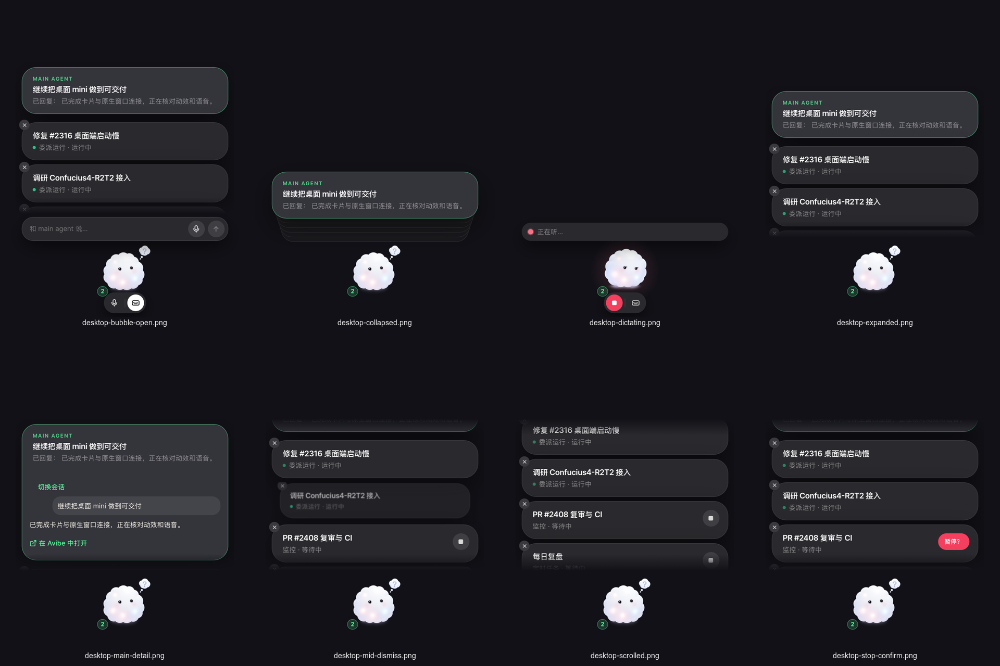

# Desktop mini v2 delivery contract and evidence

The behavior contract is [the verbatim owner specification](2026-10-12-desktop-mini-main-agent.md).
This implementation builds on the existing binding, authorization, send-ownership,
quick-reply, and pet lifecycle paths. Backend APIs are outside this change.

## Change contract

- Vibey's image box stays at `(172.5, 449, 115, 115)` in a fixed `460 × 600`
  logical-pixel window. The column grows upward; expanded content scrolls inside
  a fixed 292px viewport. Inner detail and card exits never resize the window.
- Main history is read through `api.getMainSession()`, currently adapting the
  existing pet binding. The switcher remains available in the main-card detail.
- Main detail retains Markdown, quick replies, vault actions, queue and uncertain
  send notices. Mark-read additionally waits for the result to intersect the
  fixed scroll viewport. One document-level send owner survives component changes.
  The unread badge remains until the inbox confirms the read. Without a main
  exchange, the picker remains reachable, including when sub-task cards exist.
- Background activities supply sub-task cards. Running items lead when collapsed;
  expanded order is stable and new items enter below main. Watch/task pause calls
  use their native IDs, require a second press within 3s, and wait for the response.
  Success lingers for 2.5s before the two-beat exit. Agent runs have no stop control.
  Durable `enabled` watches and `scheduled` tasks can be paused while waiting;
  only `running`/`processing` executions affect the running dot, order and busy pose.
- Dismissal writes the optional `dismissed_ids` field in `pet.json`. Old files load;
  a binding change clears the IDs. Only an authoritative turn read removes stale IDs.
- The page reports clipped logical hit rectangles. The native poller runs at 16ms
  inside the window, 100ms outside, and sleeps while hidden. Both new commands
  enforce the existing pet-only origin/caller check and capability boundary.
- Hotkey press and release are distinct. A released hotkey during page/runtime
  startup opens text rather than starting a microphone later. Hold threshold is
  320ms; leaving before the threshold cancels it. Dragging retains the existing path.
- Voice ownership remains a separate commit. Composer receives only the readiness
  wait; its dictation implementation is not refactored. Pet uses the existing
  `ShowPageVoiceDictation` wrapper and thus the same capture/transcription pipeline.

## Voice gate: deliberately off by default

No production shell currently installs `__AVIBE_PET_VOICE_ENABLED__`. Pet voice
therefore stays off on every platform, even when Web Locks and ASR are available.
Hotkey/hold open text, and both microphone controls are hidden. Missing Web Locks
also denies pet voice regardless of this marker. This follows the owner's
explicit requirement to withhold default enablement until captured-speech handoff
has been demonstrated across the desktop webviews.

In the isolated macOS desktop build, `main` and `pet` both exposed Web Locks and
reported the same `avibe.voice-capture` owner/client ID. A pet claim changed that
owner and finished the main Composer's pending dictation. **The main capture had
not produced a transcript**, so this does not prove captured speech survives a
real cross-webview handoff. Background scripted audio startup was suspended, and
the native driver refused the main mic's background AX action. No foreground
activation was requested to bypass that refusal. The release gate remains off;
no shell arbiter was added.

Independent-module unit tests share one fake lock manager and prove local
ownership/release semantics, newest-claim ordering, remote-steal finalization,
and preservation of buffered PCM through `finish()`. They do not substitute for
the missing desktop captured-speech evidence.

## Visual evidence

The task shell was built as a separate **Avibe Mini.app**, identifier
`bot.avibe.desktop.mini`, and pointed through `AVIBE_DESKTOP_ORIGIN` at a test-only
loopback server. Its real native `main` and `pet` webviews loaded a production
bundle of the branch's real Composer/PetPage components. Session, authorization,
ASR responses and microphone samples were test fixtures. No production runtime,
user session, physical microphone, or external transcription service was used.
The installed `/Applications/Avibe.app` was not replaced, and the local `vibe`
service was not restarted.

The reference was rendered from the untouched prototype source copied into an
isolated temporary directory. Both views were compared at 460 × 600 logical px,
with Vibey aligned. The prototype retains its surrounding page copy, mock tool
phrases and run stop controls; production uses the specified status fallback,
existing theme mint/background roles, and hides run stop. Its fixture also has
one fewer sub-task, so the collapsed layer height differs by one 9px step.

Individual captures:

- [Collapsed](desktop-mini-v2-evidence/desktop-collapsed.png)
- [Expanded](desktop-mini-v2-evidence/desktop-expanded.png)
- [Scrolled](desktop-mini-v2-evidence/desktop-scrolled.png)
- [Main detail open](desktop-mini-v2-evidence/desktop-main-detail.png)
- [Input bubble open](desktop-mini-v2-evidence/desktop-bubble-open.png)
- [Listening UI](desktop-mini-v2-evidence/desktop-dictating.png)
- [Pause confirmation](desktop-mini-v2-evidence/desktop-stop-confirm.png)
- [Mid-dismiss](desktop-mini-v2-evidence/desktop-mid-dismiss.png)

The listening screenshot uses the QA-only voice marker and synthetic audio; it
is UI evidence, not permission to enable production voice. For a reproducible
static mid-dismiss image, the actual CSS animations were paused at 100ms using
Web Animations, and the test harness delayed row removal. Ordinary-timing tests
separately assert the 500ms removal and 2.5s stop linger. The remaining captures
wait for the requested DOM state and its transition before native window capture.
[Measured geometry](desktop-mini-v2-evidence/geometry.json) records unchanged
Vibey bounds and window dimensions across the seven steady states.

The owner corrected spec §3.3 during review: collapsed layers now match the
front card's measured height instead of a fixed 52px. The refreshed native
collapsed capture measures a 90px front card, five 90px layers, a 135px stack,
and 45px between the front and final layer's bottom edges. The reference was
recopied from the corrected prototype source. The owner's subsequent §3.2 decision
removes the desktop backing fill, retaining all padding and geometry. The gaps
show the desktop and are absent from the native hit-region reports. The prototype
keeps its page-coloured plate solely to cover the surrounding web-page text.

## Validation

- Focused pet, voice ownership, dictation-wrapper and bridge suites: 139 tests.
- `npm run test:pet-mini`: 12 real-browser layout checks across Chromium and
  WebKit. They cover both front-card heights and 1/3/5 layers, exact stack/peek
  geometry, long-title containment, unchanged avatar bounds on expansion, and
  transparent gaps excluded from the actual hit-region reporter's output.
- UI production build.
- Desktop workspace Rust tests: 366 passed, including shell capability boundaries,
  fixed-window anchoring, optional persistence and cold-start shortcut release.
- Desktop workspace formatting and clippy for all targets/features, warnings denied.
- Separate macOS app bundle build and native screenshots above.

The PR's exact-head Codex review, unresolved-thread inventory and CI are separate
delivery gates. Windows/Linux native visual and voice handoff evidence is not
claimed by these macOS captures. Production voice stays off pending its gate.

## Review inventory

The first findings-bearing head, `6b969e9d2`, received three Codex findings:

| Root-cause class | Resolution and consuming evidence |
| --- | --- |
| Durable activity status mapping | Separate pause eligibility from execution; watch/task interaction fixtures use the producer's `enabled`/`scheduled` statuses. |
| Unread affordance preservation | Restore the existing ready-state badge and test that the inbox owns its removal. |
| Binding control reachability | Keep the picker accessible before the first exchange, with and without sub-task cards; test selecting another session in both states. |

There is one findings-bearing head so far; no root-cause class has repeated
across reviewed heads. The owner's corrected layer geometry is included in the
same repair, with the browser and native evidence above.
