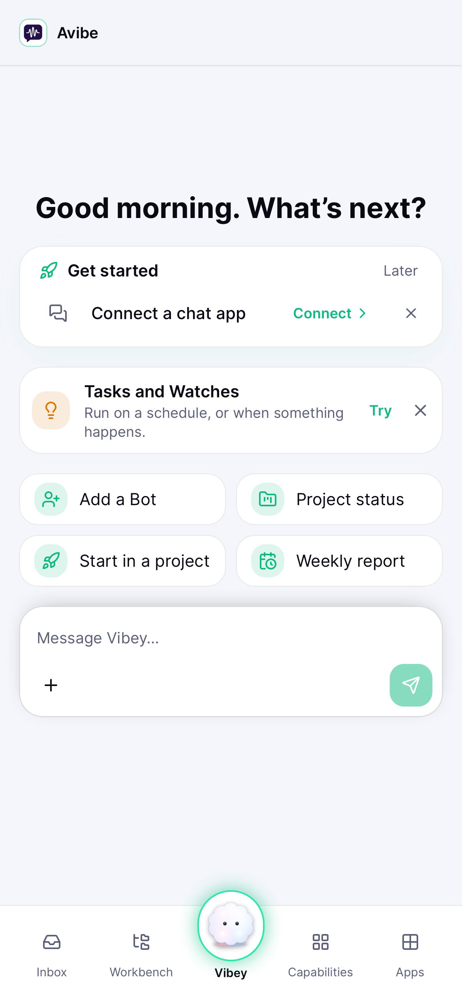
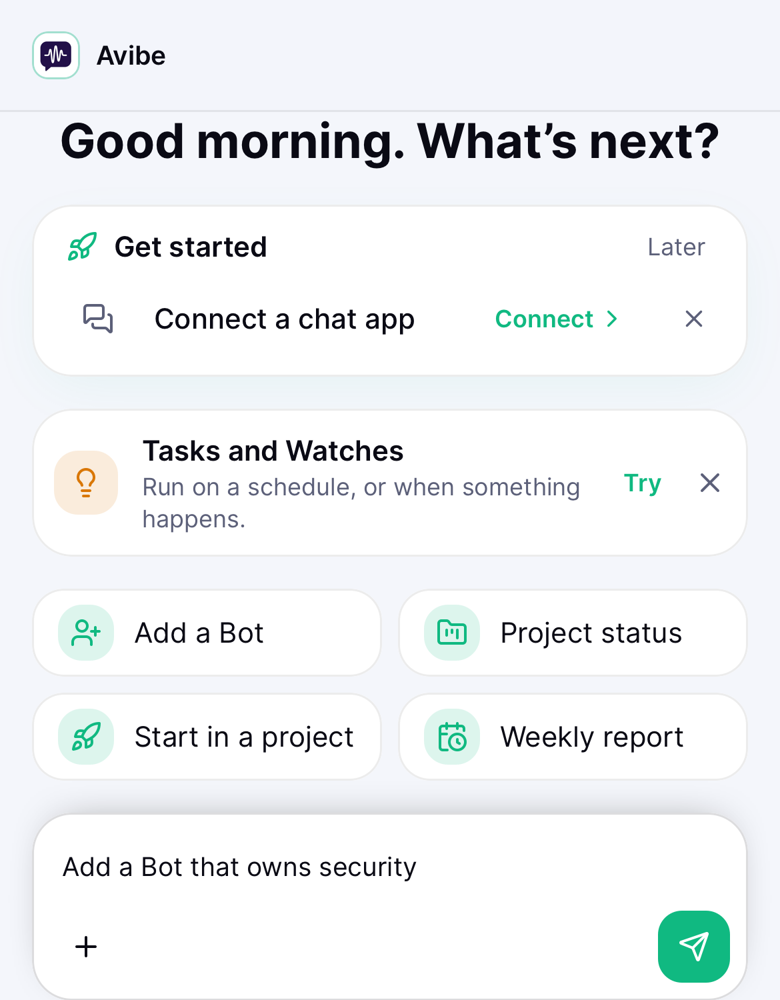
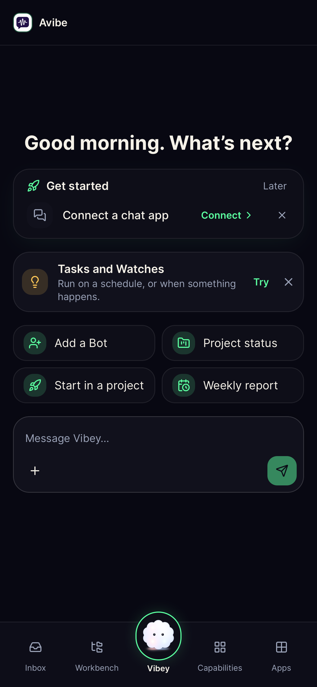
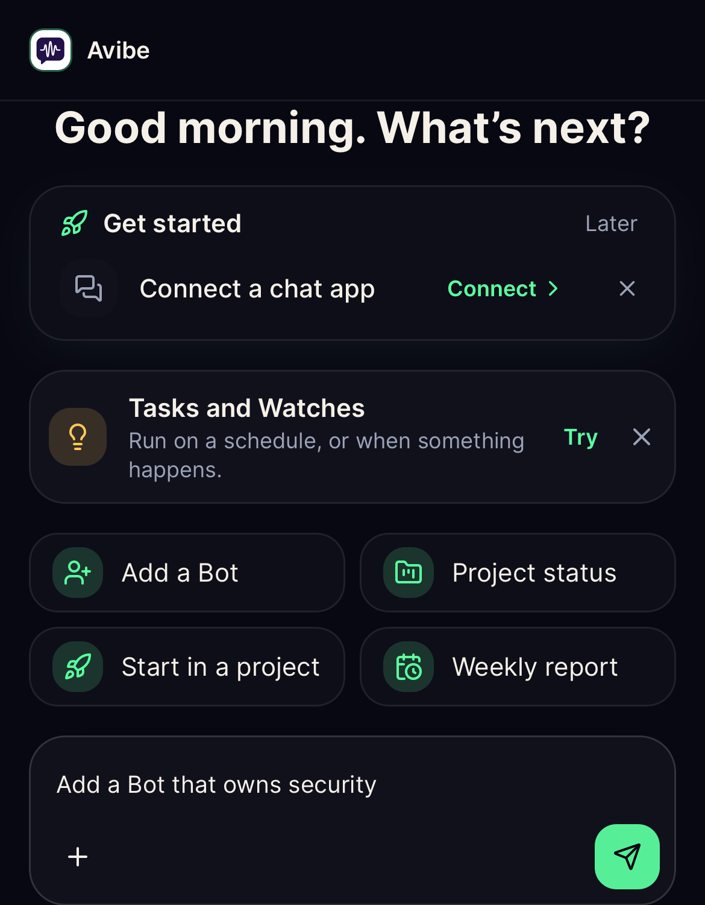

# iOS Native Keyboard Composer Visibility

## Goal

Keep the Home composer fully reachable when a quick task fills and focuses it
inside the iOS app. The native shell shrinks the runtime `WKWebView` to
`keyboardLayoutGuide`; the Web shell must respond to that ownership without
changing Safari or PWA keyboard behavior.

## Change Contract

- Only a phone-sized native shell advertising
  `keyboardResizesViewport: 1` may hide the Workbench bottom tab bar.
- Focus alone does not hide chrome. A focused text field plus a substantial
  observed viewport contraction identifies the software keyboard, so a hardware
  keyboard leaves the tab bar unchanged.
- A phone geometry change rebases hardware-keyboard focus instead of treating
  rotation as a keyboard. A software keyboard already known to be open remains
  active across rotation until the resized viewport recovers.
- While the native software keyboard is open, the tab bar and its matching
  `--mobile-nav-clearance` padding disappear together. Both return after the
  viewport recovers.
- Every Home quick task and tip that seeds the shared `Composer` continues to
  use `ComposerHandle.setDraft()`. After that method focuses the editor, the
  shared native keyboard coordinator waits for the viewport to settle and
  reveals the complete composer, including its action row.
- Chat remains a full-screen surface without the Workbench tab bar and keeps
  the existing UIKit-owned keyboard viewport contract from #3260.
- Safari and installed Web apps do not have the native capability and keep
  their existing overlay behavior.

## Evidence

- Focused Vitest covers native contraction, hardware-keyboard focus, browser
  compatibility, tab-bar clearance, restoration, and the programmatic Home
  composer reveal.
- A hermetic Playwright WebKit fixture loads the real Workbench AppShell,
  injects the versioned native bridge, clicks the real **Add a Bot** quick task,
  contracts the viewport, and proves the tab bar and clearance are absent while
  the complete composer and Send action remain visible. It also covers viewport
  restoration, hardware-keyboard rotation, software-keyboard rotation, and a
  no-native browser case.
- The browser fixture is part of the regular `ui-browser-checks` selection.

Light:

Dark:

This is a Web UI change. An iOS app can use it immediately only after the
selected Avibe instance upgrades to a release that contains the change.
